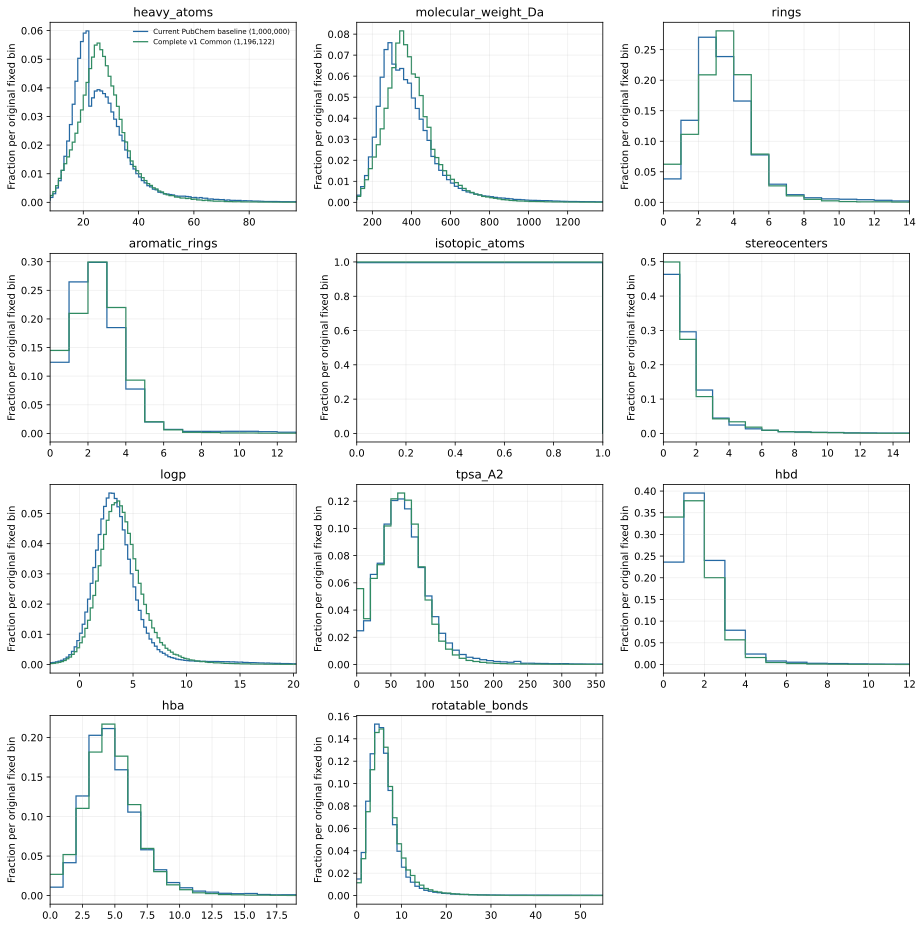
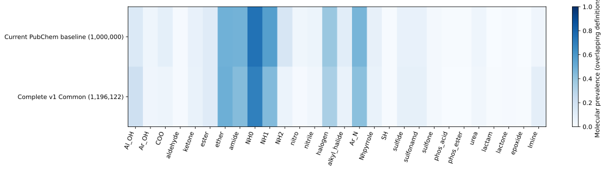
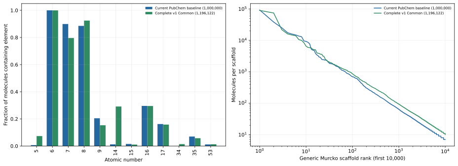

# v1 and PubChem distribution: completed population structure statistics

Purpose: compare the current fixed pre-decontamination PubChem sample with the complete v1 Common TRAIN/VAL population. This is the completed structure-statistics portion of the eventual v1_distribution.md; Task 2.1 is not yet complete.

The accepted statistics parent is Alpha 1885190 (COMPLETED, 0:0; 6,209 seconds; 16 CPUs). Common counts were reused byte-exact from accepted parent 1885178; zero Common feature rows were recomputed. The corrected baseline uses population version `alpha-original502-generic3642-recovery-v1`: seed 20261025, hash domain `PubChem-baseline-uniform`, minimum-CID full-key deduplication before v1/downstream exclusion. It replaces 31 old sample identities with 31 new identities; representative CIDs of retained identities did not change.

| Population | Molecules | Distinct scaffolds | Singleton scaffolds | Acyclic / empty scaffold molecules |
|---|---:|---:|---:|---:|
| pubchem_1m | 1,000,000 | 221,134 | 166,863 | 38,374 |
| v1_common | 1,196,122 | 185,507 | 114,742 | 74,613 |

## Figures and method

The 22 original numeric summaries use population Welford moments. All eleven descriptor panels plot the original fixed-bin probability masses as steps spanning each unchanged bin, without rebinning, smoothing, or density normalization. The common display bounds are the minimum lower and maximum upper original bin edges containing each population's 0.5th and 99.5th percentile. Underflow, overflow and every clipped tail remain in [the complete histogram CSV](artifact_index.json); these are binned summaries, not exact unbinned quantiles.

The functional group matrix uses the original RDKit 2025.09.5 recipe (28 definitions, unique matches); overlapping definitions are not mutually exclusive. The six counted inputs are read directly. No molecule, fingerprint, geometry, or database is opened and no chemistry is recomputed. Element prevalence counts molecules containing an element, divided by each full population count. Scaffold frequencies are recovered exactly from the counted frequency spectrum; tied frequencies are identical irrespective of key order. Rank plots display only the first 10,000; [the full spectrum](artifact_index.json) and [all categories](artifact_index.json) are retained.

## Observations, anomalies and limits

Current PubChem has 221,134 distinct generic scaffolds versus 185,507 in Common. This descriptive comparison is affected by population size and population composition; it is not a diversity or coverage significance test. Acyclic molecules share the empty scaffold category; it is retained rather than treated as a missing value. Functional group prevalence does not sum to one. Original outliers, explicit histogram tails and empty non-hydrogen compositions are retained; rendering introduces no screening or masking.

Empty non-hydrogen composition counted molecules: pubchem_1m=0, v1_common=0.

**Pending:** the complete one-million-query exact-nearest calculation, before/after exact coverage, 10-million R/N ordering and the first 2.5-million-molecule expansion batch are not certified by this report. No nearest-neighbour figure or empty placeholder is emitted. Conformer/D-label production, quality application and training release are separate work. This renderer does not change source selection, statistical definitions, scientific masks or acceptance thresholds.

## Exact counted input bindings

| File | Bytes | SHA-256 |
|---|---:|---|
| [numeric_summary.csv](artifact_index.json) | 1763 | `15d6bc24578816386cd151a07121f1b0da5319718c380816b428435b65ac767e` |
| [fixed_histograms_and_bin_ecdf.csv](artifact_index.json) | 137381 | `98dd7331ca7215d0de29c54980b4c3cb66b08b739f3e6c2700a3a6e8baf7b671` |
| [complete_categorical_counts.parquet](artifact_index.json) | 4673675 | `79f5ee4a2451ed41341b31c194f8741a43a530019c4a4a21c86f4c552d386b6f` |
| [functional_groups.csv](artifact_index.json) | 3614 | `45a4b61a303fd3a1e7933d2d021fa0610c93fe8e544f15257c67477fedc188b5` |
| [scaffold_frequency_spectrum.csv](artifact_index.json) | 21515 | `46731e8b02ba9bbc03a11faf9875472bc8dcf25525a725bd27cbfea98e9f2237` |
| [population_summary.json](counted_inputs/population_summary.json) | 1008 | `12d5c699a7292aee51b0e9bbc7babb0eb728ec278e589150992b05cd360351eb` |

Root statistics review: `/gfshome/alpha/codex_data_v1_20261026/control/pubchem_expansion_runtime_20261103/current_baseline_Common_statistics_1885190_root_actual_v1.json`; SHA-256 `62419f8391a004ba55c2a1e4b8447494fdcfe49001a18c674b1d6bd927869d40`.

Original functional group recipe: `/gfshome/alpha/pubchem_expansion_20261103/reports/corrected_baseline_Common_statistics_v1_job_1885190/functional_group_recipe.json`; SHA-256 `a02329470b1b9dc3a4abebd631dc97b1eb87c23da30bed0bbe862f006ab0abc7`. The actual rendering receipt records the copied recipe, renderer/source/runtime pins, all image hashes and numerical display bounds. PNG/PDF and UTF-8 vector SVG are emitted; each SVG is smaller than 2 MB. Native plot inspection and this rendering parent's terminal accounting are recorded separately by Root.

Publication note: links to the off-repository CSV and categorical Parquet tables point to the artifact index in this published copy. Their actual Alpha paths, bytes and SHA-256 and the original native Markdown binding are retained there. The repository policy keeps these tabular artifacts outside Git. See [readable statistical summaries](statistical_summary.md) for the numeric and functional-group comparisons. Other report content and counted values are retained.
