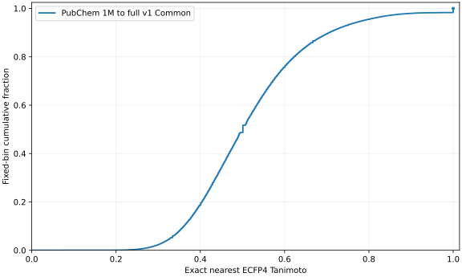
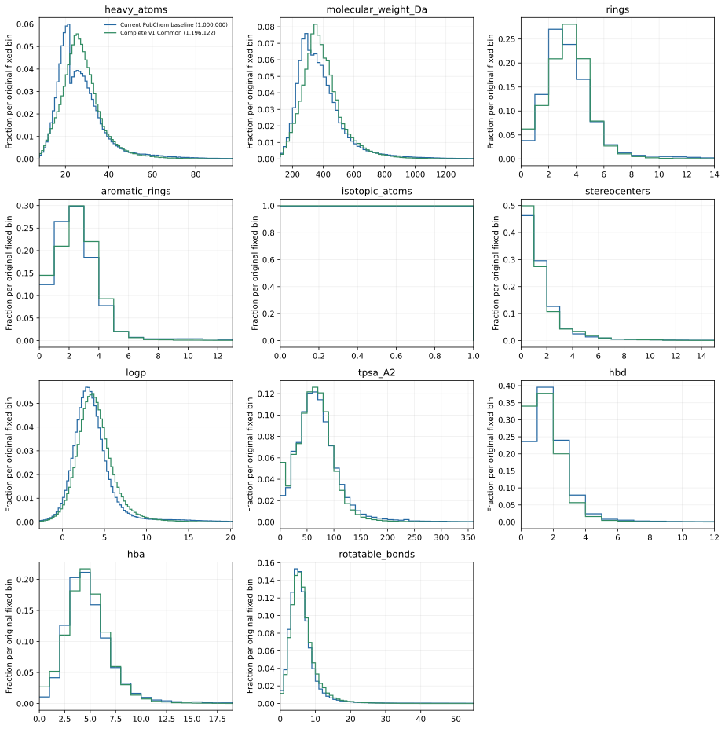
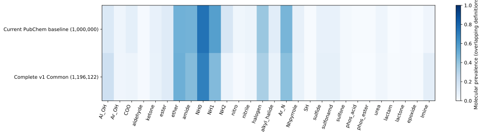
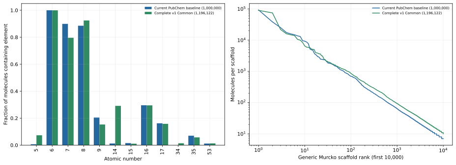

# v1 Common 与 PubChem 固定100万样本的分布及精确覆盖

任务书2.1的完整基线已完成：完整v1 Common的结构分布、同规则PubChem固定100万样本，以及这100万查询对完整Common的精确最近邻均已有实际产物。本报告不代表R/N排序、250万UFF/D或加入扩充后的覆盖分析已完成。

## 输入与方法

| 群体 | 分子数 | 不同泛化Murcko骨架 | 单例骨架 |
|---|---:|---:|---:|
| 完整Common TRAIN/VAL | 1,196,122 | 185,507 | 114,742 |
| 固定PubChem样本 | 1,000,000 | 221,134 | 166,863 |

PubChem样本取自相同X01–X05规则、相同RDKit2025.09.5标准化并按完整InChIKey/min-CID内部去重的母体，固定种子20261025及原hash域。抽样在v1/下游去污染和新颖性选取之前；不对本基准样本另作去污染。修正母体后原100万样本换入/换出各31个，当前完整成员由原183产物固定。Common不是抽样，未排除原119条后来完成结构修复的成员。

完整输入及代码、版本和SHA见[实际生产manifest](baseline_statistics_20261105/producer_manifest.json)、[统计汇总](baseline_statistics_20261105/summary.json)和[原结构统计索引](population_statistics_20261104/artifact_index.json)。关键固定输入：

- 100万基线receipt：`b123b337624c92e6e6a4b359c29a84cbb11f90bfeb1436914c3eaf77b60d656c`。
- 1,196,122个参考的196 manifest：`1ef86c58d193264af960b361a4d04691828b9402f95c77b6ddde7302840fa45e`。
- 原201完整100万结果receipt：`5e0b97f9db6e2120d62b617115e93107839b5e810bae56dddbc9825ccfa32150e`。

统计覆盖11项数值描述符、元素、重原子数区间、骨架/环系和28类固定官能团。数值均值及总体标准差使用原Welford累计；所有有限值、分箱尾部及分类计数保留。官能团沿用固定SMARTS/unique-match和版本，类别可重叠。完整源分子成员与统计记录逐条核对，没有重新筛选Common，也没有重算或改动旧描述符。

最近邻使用ECFP4（radius2、2048bits、chiralityFalse），每个不同查询FP都对全部1,196,122个原参考精确计算；固定原序号、最近键、整数分子/分母及F64规则。相同FP缓存后仍逐条输出原100万成员，不能用990,134个不同FP替代100万分子分母。未使用下游特征作排序或选样。

## 精确最近邻结果

| 指标 | 实际结果 |
|---|---:|
| 查询记录/缺失结果 | 1,000,000 / 0 |
| 不同查询FP | 990,134 |
| 最近邻Tanimoto均值 / 总体标准差 | 0.519917 / 0.141885 |
| Tanimoto < 0.4 | 18.6562% |
| Tanimoto < 0.6 | 75.6858% |
| Tanimoto < 0.8 | 95.4888% |
| 完整身份在参考中存在 | 9,790（0.9790%） |
| Tanimoto恰为1 | 16,835（1.6835%） |

完整身份匹配与不同身份的指纹相同均保留；两种计数不能互换。中位数位于原固定分箱`[0.500,0.501)`，10%/90%分位数分别位于`[0.360,0.361)`与`[0.704,0.705)`；这些是分位数所在箱，不是未分箱的精确分位数。

曲线沿用0.001分箱，最后一个有限箱包含1。原图在右边框处的终点不易看清，本图仅增加显示边距和终点标记；全部100万分箱质量及1.6835%的精确1记录保持原样。它不是未分箱ECDF。[绘图清单](baseline_statistics_20261105/nearest_figure_manifest.json)记录同SHA的Alpha原计数表与Main副本、源码、SVG/PNG/PDF及实际Main20元数据绘图进程；没有伪造Slurm分配，也没有重算NN。

## 结构分布及覆盖不足的区域

以上三图复用原完整190计数的已检查图表；254通过完整逻辑摘要检查，确认两个人群原五类统计表保持不变。描述符图连接原分箱中点的概率质量，不代表连续密度或整数之间出现新取值。显示范围为两群体分箱的0.5%–99.5%范围，完整尾部保留在原表；骨架图显示前10,000名，完整频谱可追溯。PubChem平均重原子数27.189、Common为27.103；PubChem重原子数总体标准差14.123、Common为9.723，尾部差异明显。PubChem单例骨架占不同骨架的75.46%，Common为61.85%；群体规模和组成不同，这不是加入扩充后的增益。

以下频率比定义为`PubChem比例/Common比例`，只作描述，不是显著性检验或新的选样规则：

| 区域 | PubChem数量/比例 | Common数量/比例 | 频率比 |
|---|---:|---:|---:|
| 76–100个重原子 | 8,380 / 0.8380% | 2,197 / 0.18368% | 4.56 |
| >100个重原子 | 4,138 / 0.4138% | 398 / 0.03327% | 12.44 |
| 重元素组合{C,O} | 45,392 / 4.5392% | 14,909 / 1.24644% | 3.64 |
| 重元素组合{C,N} | 42,505 / 4.2505% | 10,627 / 0.88845% | 4.78 |
| 重元素组合{C,N,S} | 16,095 / 1.6095% | 6,304 / 0.52704% | 3.05 |
| 重元素组合{C,N,F} | 11,818 / 1.1818% | 3,387 / 0.28317% | 4.17 |

元素组合忽略隐式H，表示分子的完整重元素集合。这些是覆盖统计，未参与结构去污染匹配。具体骨架例子中，泛化骨架`C1CCC(CC2CCCC2)CC1`占样本0.9297%、Common0.43482%，频率比2.14；`C1CCC(CCC2CCCC2)CC1`分别为0.8713%和0.42429%，比值2.05。完整骨架/环系计数及不存在于Common的类别均由原CSV/Parquet保留，原产物manifest列出文件路径与SHA。

低相似度是另一种覆盖不足证据。例如在至少1,000条查询的联合区间中，≤10重原子且重元素为{C,N}的1,377条查询，平均NN相似度0.39350、56.28%低于0.4；31–50重原子且为{C,N,F}的1,206条查询，均值0.40355、57.46%低于0.4；51–75重原子且为{C,N,O,F}的1,985条查询，均值0.41171、54.06%低于0.4。较低的结构频率与较低的最近邻相似度是不同指标，不宜互相替代。

上述表格、阈值比例、分位箱和例子均可从[机器可读分析](baseline_statistics_20261105/descriptive_notes.json)及[计数表分析脚本](../../workflows/expansion/summarize_baseline_counted_tables_v1.py)复现。例子筛选阈值为类别至少100个样本、联合NN区间至少1,000个查询；只用于控制报告可读性。

## 运行、异常和限制

原结构统计190实际完成16CPU/6,209秒；原100万NN201实际完成64CPU/61,924秒；报告254实际完成16CPU/1,553秒，父/batch/extern全部0:0，[原生结束记录](baseline_statistics_20261105/baseline1885254_native_terminal_20261105_v1.psv)附TotalCPU原值。原生TotalCPU显示00:00不是实际CPU耗时为零；分配核时仍按父ElapsedRaw×AllocCPUS计算，不重复计步骤。254复用原完整结构统计，只补入原201的全量NN结果；没有再运行一次100万NN。

技术UNKNOWN、未能定结构的下游记录及COCONUT隔离范围沿用各自清单；不能当作已通过化学筛选或结构去污染。本报告的固定基准样本与之后的去污染候选池作用不同。R/N排序和250万生成仍须完成全池精确评分；UFF最多3个实际构象、不补足、不科学重试，D20每分子一次、D3/原子SASA逐实际构象。加入R/N后的覆盖变化、全批质量、成本与存储将在完整batch1报告中给出。
