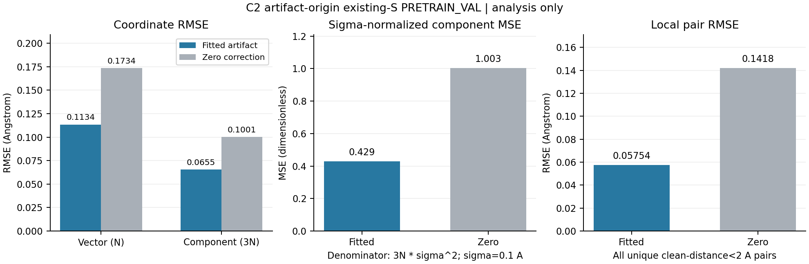

# C2 baseline v2, artifact loader v3: first fixed PRETRAIN_VAL analysis

Actual current job 4520603: Slurm C0, fixed CPU supervisor closed, independent native SDK VERIFIED.
Analysis only; no model selection gate or new metric acceptance threshold.

Parameter estimation belongs to prior TRAIN diagnostic job 4520559: 8,192 records, 436,120 atoms. The current job loads that accepted artifact, performs no parameter estimation, reads zero native TRAIN geometries, and evaluates exactly 1,024 original existing-S PRETRAIN_VAL records. Records are not molecule-uniform samples or a new D-5 split.

Target epsilon = y - x (Angstrom displacement); predicted clean coordinates = y - predicted epsilon. Noisy-distance <5 Angstrom features use 0.1 Angstrom bins; the TRAIN objective has ridge=1e-4. Unknown bins receive zero correction while every atom/pair remains in its original denominator. Local pairs are unique upper-triangle clean-distance <2 Angstrom pairs computed from the same predicted clean coordinates.

| Original metric | Value | Unit | Original denominator / definition |
|---|---:|---|---|
| `records` | 1024 | records | all fixed PRETRAIN_VAL records |
| `atoms` | 55650 | atoms | all atoms N |
| `local_pairs` | 73169 | pairs | all unique clean-distance<2 Angstrom pairs P |
| `directed_edges` | 1268550 | edges | all noisy-distance<5 Angstrom directed feature edges |
| `known_directed_edges` | 1268434 | edges | observed TRAIN bins |
| `unknown_directed_edges` | 116 | edges | zero correction; never excluded |
| `displacement_vector_MSE_A2` | 0.0128705195 | Angstrom^2 | SSE/N |
| `coordinate_vector_RMSE_A` | 0.113448312 | Angstrom | sqrt(SSE/N) |
| `coordinate_component_RMSE_A` | 0.0654994134 | Angstrom | sqrt(SSE/(3N)) |
| `explicit_sigma_normalized_component_MSE` | 0.429017315 | dimensionless | SSE/(3N*sigma^2) |
| `noisy_identity_vector_MSE_A2` | 0.0300788828 | Angstrom^2 | zero-correction SSE/N |
| `local_pair_RMSE_A` | 0.0575438344 | Angstrom | sqrt(pair SSE/P); same predicted clean coordinates |
| `noisy_identity_local_pair_RMSE_A` | 0.141805777 | Angstrom | sqrt(zero-correction pair SSE/P) |
| `local_cutoff_A` | 2 | Angstrom | fixed clean-distance analysis cutoff |
| `sigma_A_for_normalized_metric_only` | 0.1 | Angstrom | fixed normalization sigma |

| Original core role / flag / aggregate membership hash | Value |
|---|---|
| `all_atoms_in_coordinate_denominator` | `True` |
| `downstream_records_or_scores_read` | `False` |
| `evaluation_membership_sha256` | `67b5246843d8fff879bac6dea711bc60c1fa52a41f43c5f65ea6627632f6febb` |
| `role` | `PRETRAIN_VAL` |
| `status` | `ANALYSIS_ONLY_NOT_MODEL_SELECTION` |
| `unknown_bins_use_zero_correction_without_exclusion` | `True` |

| Display comparison | Fitted artifact | Zero correction (noisy identity) | Unit |
|---|---:|---:|---|
| `coordinate_vector_RMSE_A` | 0.113448312 | 0.173432646 | Angstrom |
| `coordinate_component_RMSE_A` | 0.0654994134 | 0.100131385 | Angstrom |
| `explicit_sigma_normalized_component_MSE` | 0.429017315 | 1.00262943 | dimensionless |
| `local_pair_RMSE_A` | 0.0575438344 | 0.141805777 | Angstrom |

Zero coordinate vector/component RMSE and sigma-normalized MSE above are algebraically derived from the saved noisy_identity_vector_MSE_A2; they are not new evaluations. No confidence interval or seed variance is inferred. The old approximately 0.0413 Angstrom pair-distance result is not a coordinate RMSE comparison.

Solver and objective diagnostics below are copied from bound prior TRAIN outputs, never recomputed here. The active/Jacobi explicit augmented LSQR uses damp=0, atol=btol=1e-8, iteration cap=2000, condition limit=1e8, one BLAS thread and no warm start. KKT has no acceptance threshold.

| Prior solver statistic | Value |
|---|---:|
| `solver_called` | `True` |
| `stop_code` | `2` |
| `iterations` | `74` |
| `rnorm` | `0.11458244771399494` |
| `damped_rnorm` | `0.11458244771399494` |
| `anorm` | `14.804239070263456` |
| `acond` | `189.8398800714152` |
| `arnorm` | `1.637357788950704e-08` |
| `xnorm` | `0.3185816101230982` |
| `coefficients_finite` | `True` |

| Prior original-coordinate diagnostic | Value |
|---|---:|
| `TRAIN_mean_atom_squared_vector_error_A2` | `0.01280096873298979` |
| `TRAIN_component_MSE_A2` | `0.004266989577663263` |
| `ridge_penalty` | `0.00032816859114075895` |
| `original_objective` | `0.013129137324130548` |
| `original_normal_residual_norm` | `7.689767806001955e-09` |
| `original_rhs_gradient_norm` | `0.08603697635908975` |
| `relative_original_normal_residual` | `8.937747619009087e-08` |
| `relative_normal_residual_defined` | `True` |
| `normal_equation` | `A.T@(A@c-b)/n_atoms + ridge*c` |
| `acceptance_threshold_applied` | `False` |

Prior TRAIN job elapsed: 1486 s; current VAL-only allocation: 127 s. Current process peak RSS: 934764544 bytes; recorded inner wall: 125.57 s.

Offline W&B run `10oej1zg`: exactly two committed history rows, steps 0/1, 31 total native records, all public fields/config/final summary exact, clean EOF and native exit0. Expected rows are code-derived from the fixed logger source plus saved outputs; there is no mirrored history file. Native SDK originals remain unchanged; no online sync is claimed.

Original job 4520482 remains FAILED; its original stop code/iteration count is not inferred from the later diagnostic. Artifact-loader v2 job 4520595 failed before native geometry access; the v3 registration-chain correction preserves the objective/evaluator/logger. This tool parses bounded model-owned result/closure/plan metadata (including identities already in those files), then exports only allowlisted aggregates, units, counts and source hashes. It opens no lookup/NPZ/native geometry store and exports no identities, weights, coordinates or predictions.

CSV denoise_rmse means coordinate_component_RMSE_A; code_sha/preregistration_sha identify the publicly adopted artifact runtime protocol. Its complete executed source inventory is separately byte-bound. Hashes and input/output source manifest are in report.json / REPORT_COMPLETE.json.

## Diagnostic publication mapping

Executed local diagnostic commit: `c65db8b647eb4d39360e31478c4c63368cd84a43`; public diagnostic commit: `cd0c434bb39824cd75c24d7c6de0531946da1de5`. Producer-verified common tree: `eecadc77e71a4d290f7a6b00c7d0906e14e58f3f`; protocol raw SHA: `415f1fa96d0a510fa5c7eeeca381b27603edecba6d27ac1b01bc43712e847961`. This reporter independently matches the complete model-owned prior input/binding/mapping metadata chain. The pinned v3 producer performed the actual Git blob/method/source/tree checks; the reporter does not re-run Git or infer commit equality.

## Execution and publication closure

The actual adopted local protocol commit is `916697e0053524e6a2a3bdec81c30d3691f07ee8`, published before VAL as `0f26274af9271e93eb148740711a5352855c5ae2`; exact common tree `87d533a3fc0b962d50933528e3102e52511b1426`.

Loader tests599:40 PASS/C0/60s; real TRAIN-only artifact probe602:C0/6s; report tests601:44 PASS/C0/67s; actual independent SDK/report606:C0/4s. All sources unchanged. CPU jobs use admitted CPU nodes, at least16 CPUs. Root reviewed the actual three-panel PNG.

The full plot PDF remains outside Git at `runs/model_v3_20261025/C2_actual_SDK_report_4520606/metrics.pdf`. The standalone executed rendering source is snapshotted under `tools/model_v3/analysis_sources/c2_artifact_v3_reporting/`; immutable original report/PNG/PDF hashes are in the report manifest. This Markdown only changes the figure link and appends this closure.
