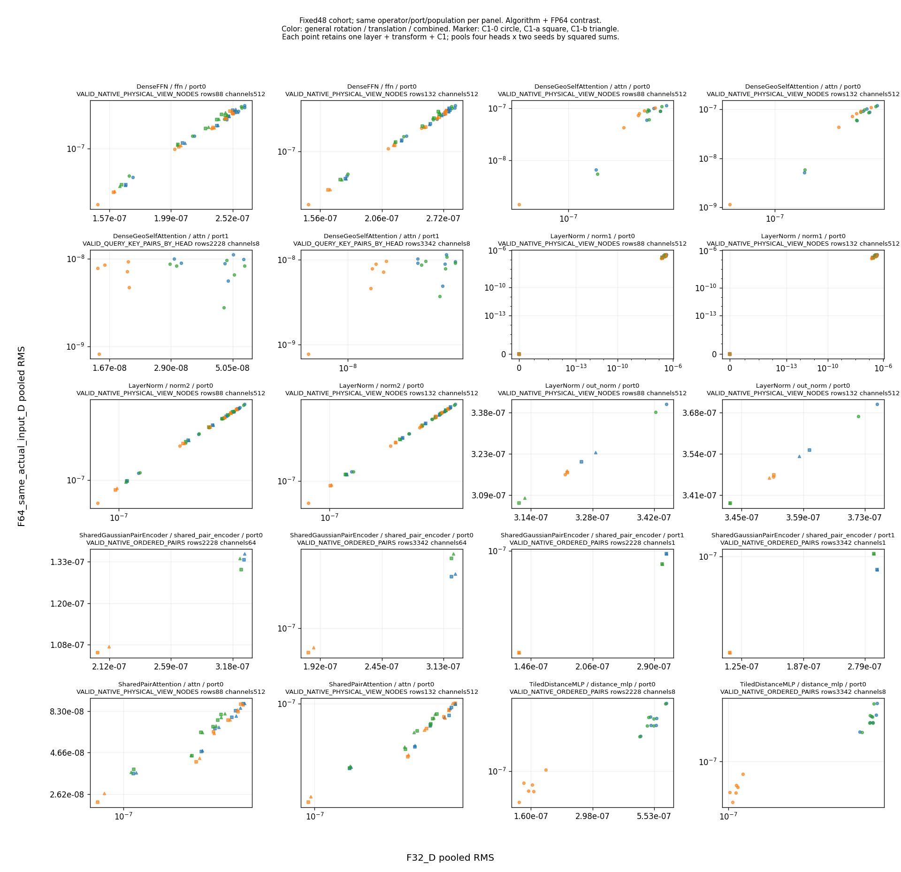
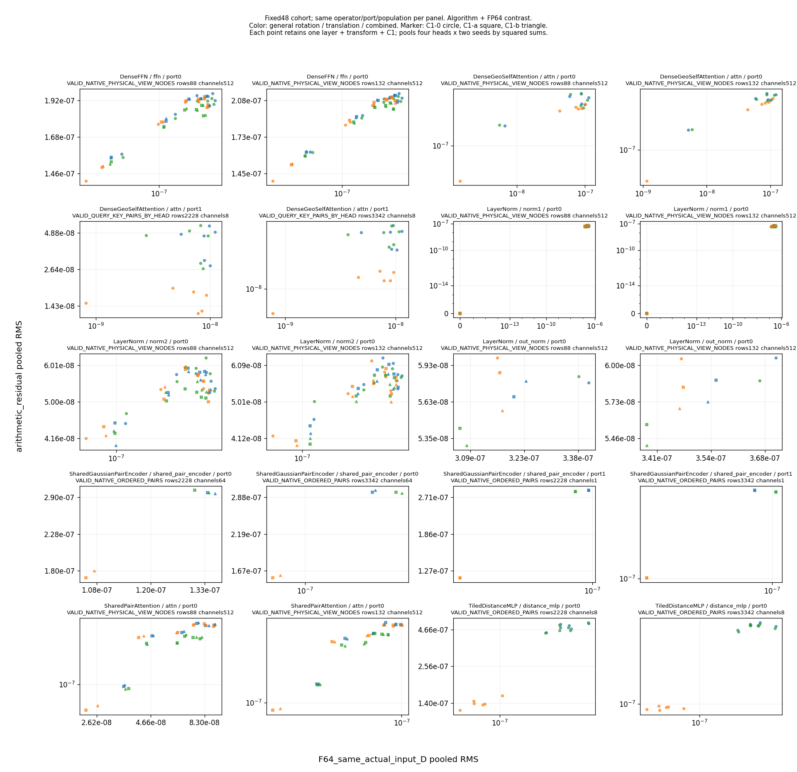

# 模型 v3：2026-10-27 训练前准备与实际验证

本报告记录三个独立候选的相关 CPU 验证、固定 48 案例的局部误差分析，以及新增八段 W&B 同步。阶段 2、3、5、6 的完整科学验收和最终冻结仍未完成。

## 问题、规则与版本

本轮检查 Native 权重桥接、配方证据规则及 A1/A5 真实执行路径。相关 CPU 测试不能代替完整整合回归、真实 GPU 数值与速度、D-3/D-5/D-6 实验。完整 local/public SHA、实际 sacct、测试 XML 和源码冻结引用见[机器证据](pretraining_preparation_compact_evidence_20261027_v1.json)。

| 候选 | 实际 CPU 父作业 | 相关测试 | 失败/错误/跳过 | 已发布的方法与代码 |
| --- | --- | ---: | --- | --- |
| Native 检查点与 H0 桥接 | 4522290，node15，22秒，16CPU | 74 | 0/0/0 | [60aa359](https://github.com/mint258/MFM/commit/60aa359443ef6a79aabc08144d2af4eec7ec24c5) |
| 配方与全量训练证据工具 | 4523127，node15，33秒，16CPU | 120 | 0/0/0 | [727207f](https://github.com/mint258/MFM/commit/727207f18f08d6107c08ce2dc3e95edd154d60c7) |
| A1 检查点策略与 A5 逻辑批次分块 | 4523519，node12，22秒，16CPU | 99 | 0/0/0 | [8147f44](https://github.com/mint258/MFM/commit/8147f44baa1ea1ecc3822af7affd0a95401ed248) |

三行测试有重叠，不能相加解释成唯一测试总数。各自仓库检查器已通过。A1/A5 包装时仅增加保留历史 CRLF 清单原始字节的 Git 属性，补充作业 4523705 实际 C0。旧 4523408 的 98通过/1夹具失败及原快照保留；v4 换成真实 Dropout 夹具后仍执行原阈值和全部99项。

Native producer、evaluator 与 API 发布提交分开记录。三项目前位于独立候选分支，本报告不证明最终统一运行树的全量回归已经完成。

## 固定 48 案例的局部误差结果

问题是 FP32 等变性误差在各局部算子的实际输入上如何表现。原方法在 [1f7f255](https://github.com/mint258/MFM/commit/1f7f255fd412cd53ce7f6913ddbb43645d9f9ee7) 已于 GPU 采集前公开。保留6层/512维、H0、案例和原门槛，局部 FP64 参考没有注入完整编码器。

| 项目 | 实际结果 |
| --- | ---: |
| GPU 采集父作业 | 4523505，node21，175秒，C0 |
| 固定案例 / 编码器前向 | 48 / 192 |
| FP32 局部重放 / 同实际输入 FP64 参考调用 | 5312 / 5312 |
| 局部观测 / 汇总组 | 4368 / 546 |
| 原终端控制 | 2496 |
| 原物理等变性检查 | 21通过 / 27未通过 |
| 最终统计绘图父作业 | 4523831，node14，9秒，16CPU，C0 |

见[546组统计](local_op_precision_3505_scalar_summary_v3.json)和[Root核验](local_op_precision_3831_Root_closure_v1.json)。123份输入与解释源码前后及当前 SHA 一致。原48案例的 H0、局部重放和历史终端控制逐位一致。

两图按相同算子、端口和实际人群分面；每点保留层、变换与 C1 身份，仅按平方和合并原四种预测头和两个权重种子。零值保留，不跨模块或人群相加。

该参考涉及算法与精度差异，不是纯 dtype 对照。局部误差减小不能证明完整模型通过、全模型因果层排名或某 API 必须改变。正式 FP32 原绝对误差门槛 1e-5 保持；27项失败仍待解决。

[复现脚本](../figures/local_op_metadata_reducer_v3/reducer.py)、[方法](../figures/local_op_metadata_reducer_v3/METHOD.md)和[原始绑定](../figures/local_op_metadata_reducer_v3/source_pins.json)随报告保存，消费原绑定 run 元数据。8,833,407字节 observations.csv 在仓库外；Root 没有在登录节点解码 CSV、NPZ、SDK 或权重。

统计作业4523706与图形修订4523810、4523831均实际C0。三次CSV的 producer SHA/字节相同；546组及所有非来源 summary 字段完全一致。原图刻度拥挤、v2窄范围轴缺少数字的历史图保留；本报告采用目视核验后的v3。改动只影响刻度显示，数据、轴范围、symlog、零值和统计不变。

## 持久化记录

新增八段既有 Native S 日志实际同步并核验了原运行 ID、结束状态、全部已存历史和配置/汇总字段：

| 原段 | 同步 CPU 作业 | 原运行 ID |
| --- | --- | --- |
| 10–12 | 4523356，C0 | ubepmjz6、cqwzsdo5、tue9i40r |
| 13–14 | 4523357，C0 | dcuyh7s8、6vnvjx06 |
| 15–17 | 4523620，C0 | 54bc13c2、owpv593j、wqn86in5 |

Root闭合及统一入口追加回执见机器证据。原4523358在同步前因测试临时符号链接计量规则失败，原件保留；修订仅允许显式 metadata_tmp 内部无跟随测试链接，生产 W&B、私有存储和原资源限额保持。成功重试同时通过原4项QA和同会话6项自检。原 SDK 未改，没有重跑训练。

## 决策、剩余工作与限制

保留三个经过相关 CPU 核验的候选，继续完整整合回归与 GPU 验收。A1/A5 按已公开方法先做 manual 模式，保持原20固定批次前向/全部参数梯度及500步损失轨迹门槛。R2双模型容量不能冒充R1单模型或完整ABBA速度结果。

既有S fallback首个seed0/FP32成员安全保存到17,000步，使用原TRAIN记录采样。它是描述性实现验证，不能代替D-5按分子代理人群、两精度各两种子20,000步、架构选择、预算平台或种子SD。

最终D-1–D-7未齐；draft4模型意见已独立公开，不自行生成标签或把合成/既有S结果冒充新标签验收。真实过拟合、三卡SDP冒烟、架构/头对比、配方扫描、全量预算、120k分子/k2/1M样本端到端、冻结配置、最终交接、标签和PR均仍待完成。配方与B*须在实际结果后由用户确认。
