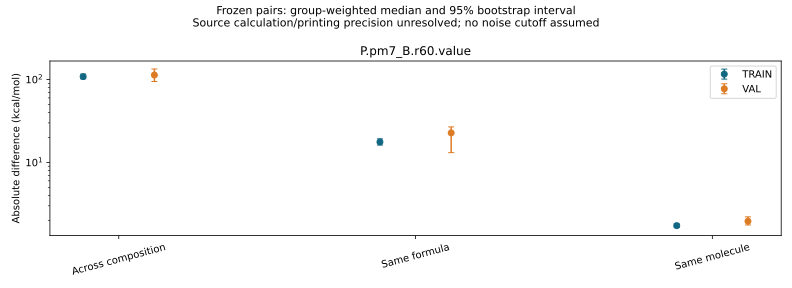

# P标签信息完整性与结构区分度：最终报告

阶段0–5已执行，包含按任务书保留的明确UNRESOLVED项。新训练0、GPU0；条件2B新增8次PM7单点，原设置输出复用8次，xTB新调用0。没有改生产标签、mask、归一化、模型或其他在跑任务。

## 主要发现

**部分标签确有稳定的条件结构信号，同时存在目标幅度悬殊和历史数值量化损伤。** 本次不能用一个总分把整个P判为好/坏，也没有测量编码器容量、梯度份额或下游训练收益。

- PM7生成热的原F64 TRAIN中位差：跨组成 **108.355**、同式异构 **17.6593**、核心构象 **1.73026 kcal/mol**。核心构象95%分子bootstrap区间[1.6415, 1.82023]，独立分子2984。这里是生成热，不能改称结合能。
- 当前D4已经对生成热扣元素参考；其跨组成幅度 **0.84297**，构象幅度 **0.0615653**，量级参照约 **13.7倍**。原单位跨度不能直接冒充当前目标跨度，更不能冒充梯度比例。现有A1只新增处理10个COSMO面积/体积与1个FOD字段，没有修改能量字段；覆盖和幅度见A1_scope_and_amplitudes.json。不能把其已有训练增益直接当成能量构象学习改善的证据。
- 已发布A1把COSMO面积的构象目标幅度从0.0507917变为0.195434，约3.85倍；体积从0.0138985变为0.247498，约17.8倍。跨组成幅度仍为约0.75–0.81。这直接支持目标尺度可显著改变构象信号的相对权重；实际梯度份额未测。

- 已恢复原F64的43个图标量与35个坐标无关原子/pair标量。局部变化并未被分子平均抵消：TRAIN核心Mulliken电荷的构象RMS中位数0.0132833 e、xTB电荷0.00726490 e，对应当前D4幅度0.0356645与0.0484314；PM7 Fukui-minus为0.205477。它们是数值条件差异，不是全域可靠性证明；31个原向量字段的全量参考系链仍未知。
- 源原始数值并非都无损保留：TRAIN PM7总能量r83在23432个源非零冻结构象对中有414对转为pilot零差；xTB总能量r670为89/23448，生成热r60为1/23447。它们是数值计数，不是已证明的物理信息损失率；核心/富集、几何层与分子等权率另列。
- 4个预定分子的生成热构象差在十倍收紧SCF后，改变最大约1e-5 kcal/mol；源输入逐文件/bundle及原二进制哈希均匹配。这只支持4分子的设置稳定性，不能提供全域噪声界或半经验方法的物理准确性证明。相同8次输出也展示小能量差的F32相对畸变，见阶段5。
- 42961条冻结记录全部连接到当前D6并有原子映射；实际CPU监督准备未观察到相对D6的额外数值变化、预期mask或pair端点错配。native base→pilot→D6及CPU准备未观察到存储坐标差异被新增合并；不替代原程序向量参考系的未解决项。

## 范围与单位

旧pilot母集50000 TRAIN+5000 VAL，全部连接现行身份；应用既有TRAIN排除8个，不从外部补入。正式面板4269 TRAIN+396 VAL，42961条允许P记录；25406+2371个冻结构象对、1322+57个同式连接异构对、1500+150个不共用分子的跨组成对。核心/富集和TRAIN/VAL分报，不把构象对当独立分子。

109个启用字段保持固定。正式配对按native_record_id的无序物理对作预定hash；原局部索引实现相关结果已作探索性历史保留，更正不依据标签选择成员/参数。详见[执行更正](CORRECTION_NOTE.md)、[来源访问范围](SOURCE_ACCESS_NOTES.md)。

## Q1–Q7

1. **定义与条件：** 已登记单位、方法、任务指定电荷/电子态、环境、几何与原子约定。原生TOTAL ENERGY与生成热的组成项不同，见[能量定义](ENERGY_DEFINITIONS.md)。头身份能固定任务条件，不能只因输入无独立电荷变量便判断缺条件；形式电荷也不替代实际QM电荷。逐记录真实基态、自旋纯度及方法准确性未全面验证，r674关闭及历史参考系失败/UNKNOWN保持。
2. **结构覆盖：** 42961记录对应固定0.5Å口径30067个代表；27777正式构象对中21424个重原子RMSD≥0.5Å。覆盖真实变化，同时保留近似重复；几何不同不要求能量单调或任何一个标量都不同。
3. **条件差异：** 原始F64图标量、坐标无关原子/pair标量与pilot对齐向量分别给原单位差、独立单位、CI和局部RMS/最大值。组成参考、残差与尺度分开。扰动能量/梯度路线单列，不能把扰动造成的改变完全归于原始构象。异构主比较是有效构象中位数差，附首个允许构象差及范围；不全归因为连接关系，不当作热力学平均。
4. **可分辨性：** F64/F32容器和原始解析值不同均不自动等于可靠化学差异。2B支持4个固定PM7案例的数值稳定性；其观测最大改变不当全域误差界。源打印/SCF精度缺口继续逐字段null。原向量参考系集成因两次实现故障依任务书上限停止，不等于向量标签物理上无定义。
5. **重复/互补：** 已列可证明的代数与来源关系、固定条件距离相关、状态−中性对比。未获得与字段/维度/位点数匹配的全域误差对照，联合检出率与独有补充分辨率为UNKNOWN；完整家族Holm集合中未知p=1占位，科学状态仍null。少量SCF案例不校准这些全域率。
6. **缺失：** 记录mask、两端共同mask、可比较配对、每分子0–6对分布，均按来源、重原子、Strict可旋转键、真实几何覆盖和任务状态分层；稀有类别给实际分母。数据mask与物理可比较/实际loss有效性分开，未补零或因离群删除分子。
7. **训练端保留：** 同物理记录从原图/局部标量到pilot、当前D6、既有D4/A1及实际CPU监督张量分段追踪。量化、样本暴露/掩码、可逆参考/尺度改变分开；跨组成和同式追踪保持同一冻结记录集。原始向量全量链仍未完成。数据准备保留不等于编码器/优化器能利用，实际梯度与迁移影响未实验。

## 家族与比较层级

下表前三列为pilot层“至少一次非零数值差的字段/可比较字段”，第四列为已恢复原F64图/局部标量字段数。它不是信息总分、独立样本数或准确率。0/0是本层无合法对应，不能称预期不敏感；完整TRAIN/VAL矩阵见conclusion_matrix.json。

|家族|跨组成|同式|核心构象|原F64标量字段数|全域计算可靠性/校准互补率|
|---|---:|---:|---:|---:|---|
|bonding|0/0|0/0|6/6|3|UNKNOWN|
|charge|0/0|0/0|17/17|17|UNKNOWN|
|energy|7/7|7/7|17/17|10|UNKNOWN|
|frontier/IP-EA|12/12|12/12|12/12|12|UNKNOWN|
|multipole|0/0|0/0|12/12|0|UNKNOWN|
|off-equilibrium|0/0|0/0|3/3|0|UNKNOWN|
|reactivity|1/1|1/1|11/11|11|UNKNOWN|
|response|0/0|0/0|2/2|2|UNKNOWN|
|size|17/17|17/17|17/17|17|UNKNOWN|
|solvation|6/6|6/6|6/6|6|UNKNOWN|

## 证据与交付

- [阶段0](00_SCOPE_AND_SEMANTICS.md)、[结构覆盖](01_STRUCTURE_COVERAGE.md)、[精度与2B](02_NUMERICAL_RESOLUTION.md)。
- [原条件信息](03_CONDITIONAL_INFORMATION.md)、[原F64补充](03_ORIGINAL_CONDITIONAL_SUPPLEMENT.md)、[原始图标量追踪](ORIGINAL_SCALAR_EVIDENCE.md)。
- [联合与缺失](04_JOINT_INFORMATION_AND_MISSINGNESS.md)、[处理链](05_PIPELINE_RETENTION.md)、[提交记录](COMMITS.md)。
- 核心JSON与图在results/p_data_information，完整成员/物理配对/必要缓存保存在外部runs/p_data_information_20261115_v1。没有全1.19M标签扫描、完整库复制或新全源索引。

默认仓库检查在独立稀疏源码工作树运行，不能宣称原整仓202项历史错误已清除。专用核对覆盖原子映射、proper几何/拒绝反射、差值/矢量组装、物理ID配对重编号与固定记录集；不增加重复全量验收。未知项和执行故障与物理定义问题分开保留。

待议：依据本结论另定固定预算的输入精度/目标尺度及共享梯度对照；本版不执行。
