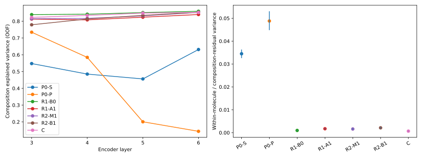

# A：表示塌缩的组成来源检验

## 范围与方法

固定5000个VAL分子，复用diagnose.validation_indices（seed20261112）。组成分析取首允许构象；构象分析覆盖同一分子的全部允许k10构象（每条件47698条记录）。只用指定检查点，P0-S/P为6M，R1-B0/A1、R2-M1/B1为3M；C/D使用各自指定3M端点，原8个条件均已完成。未启动额外模型训练。

第3–5层取中间输出，第6层取out_norm后输出；B1取共享投影器之前。原七条件为GPU前向，D由CPU任务4535800完成；encoder计算均为F32，各构象mean(H)暂存为F32，统计为F64；原子H只流式累计元素矩，不落盘。每个条件完成后删除其mean(H)缓存。

Xc使用既有D4元素参考基底的元素计数，并加入总原子数/重原子数；Xsize只用后两列。按MID做5外折交叉验证，5内折只在外层训练折选择ridge参数（1e-3至1e3，每次乘10），折内拟合标准化及不惩罚的截距。CEV是多输出OOF解释方差1−SSE/SST；CEV_size使用Xsize。PC1–3来自首构象mean(H)的全样本F64 PCA轴，其OOF R²仅作描述。

EEV为按元素分组的原子H组间平方和/原子总平方和。CVF为同分子构象内平方和/总平方和；CVF_res将每个构象减去该MID的组成OOF预测后计算相同比值，均限有至少2个允许构象的分子，并按实际构象记录加权。1000次配对MID bootstrap（seed20261025）重采分子及其全部构象，复用固定OOF预测，不重新拟合。以下区间均为95% percentile CI。

## 第6层表示结果

|条件|状态|CEV|CEV_size|EEV|CVF|CVF_res|
|---|---|---|---|---|---|---|
|P0-S|COMPLETE|0.63139 [0.61318, 0.6446]|0.4799 [0.45437, 0.50003]|0.55687 [0.55608, 0.55778]|0.012526 [0.011933, 0.013122]|0.034483 [0.032583, 0.036326]|
|P0-P|COMPLETE|0.14377 [0.10679, 0.1749]|0.13836 [0.10471, 0.16558]|0.56439 [0.55282, 0.57537]|0.043053 [0.039505, 0.04708]|0.048797 [0.044799, 0.053048]|
|R1-B0|COMPLETE|0.85936 [0.83228, 0.87668]|0.56909 [0.53635, 0.59702]|0.99806 [0.99805, 0.99808]|0.00012501 [0.00011943, 0.00013171]|0.0009681 [0.00085807, 0.0010818]|
|R1-A1|COMPLETE|0.84003 [0.80202, 0.86455]|0.83715 [0.80162, 0.86036]|0.99532 [0.99461, 0.99598]|0.00024393 [0.00023012, 0.00025836]|0.0017094 [0.0014699, 0.0019738]|
|R2-M1|COMPLETE|0.85258 [0.82249, 0.87468]|0.60651 [0.58571, 0.62389]|0.99789 [0.99787, 0.9979]|0.00021767 [0.00020372, 0.00023208]|0.0015985 [0.0013595, 0.0018625]|
|R2-B1|COMPLETE|0.85339 [0.82741, 0.87043]|0.53421 [0.50181, 0.56151]|0.99418 [0.99407, 0.99425]|0.00028372 [0.00027102, 0.00029885]|0.0021146 [0.0018854, 0.002359]|
|C|COMPLETE|0.85227 [0.81684, 0.87486]|0.83178 [0.80095, 0.85274]|0.99766 [0.99762, 0.99769]|9.1347e-05 [8.6391e-05, 9.6857e-05]|0.00067027 [0.00058423, 0.00077533]|
|D|COMPLETE|0.41388 [0.40147, 0.42429]|0.24301 [0.2291, 0.25466]|0.76535 [0.7637, 0.76717]|0.15347 [0.14768, 0.16007]|0.25905 [0.24911, 0.26925]|

## 预注册判定

支持要求CI下界>0，且点效应≥max(0.10,0.20×右侧参照)；H5参照固定为P0-S第6层CEV。CI上界<0.05或全区间≤0为NOT_SUPPORT，其余为UNCERTAIN。H1与H4同时获支持才允许组成来源/构象压缩的联合声明。

|假设|差值定义|效应及95%CI|支持效应阈值|判定|
|---|---|---|---:|---|
|A-H1|CEV6(P0-P) − CEV6(P0-S)|-0.48762 [-0.52445, -0.45211]|0.12628|NOT_SUPPORT|
|A-H2|CEV6(R1-B0) − CEV6(R1-A1)|0.019325 [0.0056138, 0.034111]|0.16801|NOT_SUPPORT|
|A-H3|CEV6(R2-M1) − CEV6(R2-B1)|-0.00081165 [-0.018977, 0.011613]|0.17068|NOT_SUPPORT|
|A-H4|CVF_res6(P0-S) − CVF_res6(P0-P)|-0.014314 [-0.017903, -0.010851]|0.1|NOT_SUPPORT|
|A-H5|(CEV6−CEV3)(P0-P) − (CEV6−CEV3)(P0-S)|-0.67459 [-0.71447, -0.62838]|0.12628|NOT_SUPPORT|
|A-H6|CVF_res6(D) − CVF_res6(C)|0.25838 [0.24846, 0.26862]|0.1|SUPPORT|

H1与H4联合声明未获支持，不能据此将P的既有谱塌缩主要归因为组成或构象压缩。

R1-B0减A1虽为正差，仍未满足预注册支持标准；不将其改判为支持。

## 实际训练目标参照

仅纳入该条件实际训练且有效比例≥99%的P分子标量，使用该检查点实际D4/A1参数，按每字段目标方差加权汇总CEV与CVF。该参照只作描述。

|条件|纳入目标分量数|目标CEV（方差加权）|目标CVF（方差加权）|
|---|---:|---|---|
|P0-S|NA|NA|NA|
|P0-P|43|0.32807 [0.30316, 0.35165]|0.064131 [0.059252, 0.068527]|
|R1-B0|43|0.32807 [0.30316, 0.35165]|0.064131 [0.059252, 0.068527]|
|R1-A1|43|0.10752 [0.093824, 0.12101]|0.095409 [0.08774, 0.10206]|
|R2-M1|43|0.10752 [0.093824, 0.12101]|0.095409 [0.08774, 0.10206]|
|R2-B1|43|0.10752 [0.093824, 0.12101]|0.095409 [0.08774, 0.10206]|
|C|33|0.13631 [0.11832, 0.15292]|0.085725 [0.078062, 0.092506]|
|D|66|0.063516 [0.050893, 0.075765]|0.53343 [0.50638, 0.55823]|

D行的66为33物理字段的t1/t2目标分量计数，沿99存储字段/87物理损失项口径。t1/t2按实际分量mask分别执行99%有效比例门槛，各带原字段一半权重；详细条目同时标明物理字段和分量。S条件没有训练P标量目标，参照为NA；指定C/D条件未完成时也记NA。

逐层指标、PC1–3描述结果、每字段目标参照、精确检查点及参数路径见results/p_followup/A_collapse_composition/summary.json和metrics.csv。缺失条件不由其他运行替换；不追加检验或阈值扫描。组成解释率本身不证明独立化学准确性或迁移收益。
