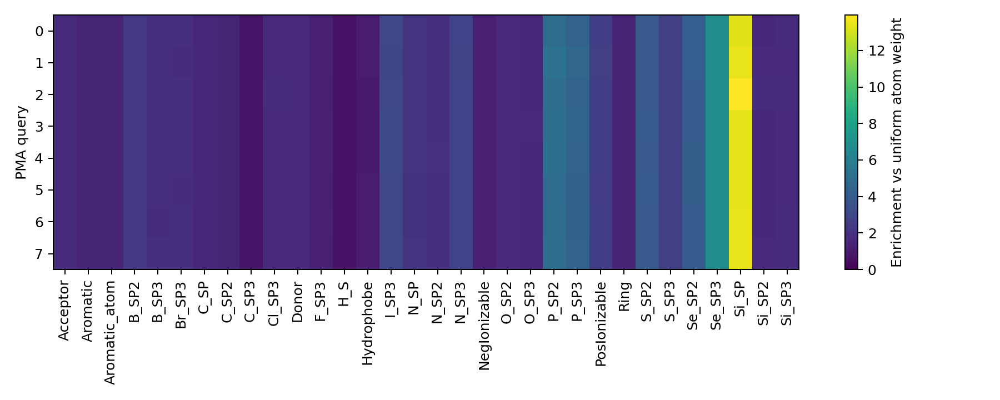

# H6：PMA 注意力的化学落点

预注册判定：**NOT_SUPPORT（不支持）**。8个query均有达到富集门槛的类别，但归一化注意力熵中位数为0.958551，达到预注册“≥0.95，近似均匀”的不支持条件。该结果不表示权重严格均匀。577维PMA向量由512维query块、64维sigmoid门控求和项和1维logN组成；H6只分析query→atom softmax注意力，T3也仅均匀化这条通路，门控求和项保持原样。因此本判定不能扩展为所有PMA加权都均匀；该query注意力通路的迁移收益仍由T3消融检验。

固定使用与H1相同的5000个预训练VAL分子，每分子取第一个允许构象。D6无直接总电荷列，以完整原始中性PM7原子电荷和的最近整数作为总电荷，用RDKit DetermineBonds从元素和坐标重建；在CPU生产步骤唯一一次核对元素序列。5000个分子均成功，排除0个。GPU阶段复用完整类别缓存，没有重复重建或对齐。未定位到现成28类SMARTS交付，不等待。

类别包括元素×杂化、芳香、成环以及RDKit BaseFeatures.fdef的Donor、Acceptor、PosIonizable、NegIonizable、Aromatic、Hydrophobe。读取B3 PMA首次query-to-atom交叉注意力（8 query×8 head×原子）。主分析先平均8个头；逐头均值只在JSON的head_mean_enrichments附表；维序为head×query×category，category顺序由categories列出。

每分子、每类别的富集比为该类别原子的平均注意力除以1/N；在出现该类别的分子间取均值。按分子进行1000次bootstrap（seed=20261025），95%百分位CI。熵为−Σa log(a)/log(N)，报告各query在分子间的中位数和所有query/分子的总中位数。

支持要求至少4/8个query各有富集≥2且CI下界>1的类别，且8个query的熵中位数全部<0.9；总熵中位数≥0.95为不支持，其余部分支持。

|Query|熵中位数|示例达标类别|富集比及95%CI|含该类别分子数|
|---:|---:|---|---|---:|
|0|0.958512|Si_SP|13.2945 [13.2945, 13.2945]|1|
|1|0.958389|Si_SP|13.4836 [13.4836, 13.4836]|1|
|2|0.958354|Si_SP|13.9431 [13.9431, 13.9431]|1|
|3|0.958634|Si_SP|13.3639 [13.3639, 13.3639]|1|
|4|0.958349|Si_SP|13.3964 [13.3964, 13.3964]|1|
|5|0.958758|Si_SP|13.3741 [13.3741, 13.3741]|1|
|6|0.958403|Si_SP|13.4451 [13.4451, 13.4451]|1|
|7|0.958898|Si_SP|13.5068 [13.5068, 13.5068]|1|

部分高富集类别只在极少分子中出现，上表保留对应分子数；不据此追加或调整预注册阈值。完整类别富集值、分子数和区间见results/p_heads/H/H6_attention.json。

附加描述：对frontier/IP-EA家族的线性PMA头，将前512维按8个64维query块分组，计算每块线性权重Frobenius范数×该块逐维标准差向量的L2范数（√Σ64维方差，5000分子总体统计）；取最大贡献query，报告其Donor/Acceptor/Aromatic富集。此项不参与判定。

|字段|最大贡献query|Donor富集|Acceptor富集|Aromatic富集|
|---|---:|---:|---:|---:|
|P.pm7_B.r49.value|7|1.71783|1.76188|1.46488|
|P.pm7_B.r50.value|0|1.69284|1.76803|1.46512|
|P.pm7_B.r61.value|7|1.71783|1.76188|1.46488|
|P.pm7_B.r63.value|3|1.70548|1.77993|1.4647|
|P.pm7_octanol.r341.value|1|1.70793|1.76573|1.46872|
|P.pm7_octanol.r343.value|2|1.69452|1.7778|1.46057|
|P.pm7_water.r408.value|5|1.71146|1.76124|1.46868|
|P.pm7_water.r410.value|0|1.69284|1.76803|1.46512|
|P.xtb_singlepoint.r671.value|6|1.69549|1.77307|1.46495|
|P.xtb_singlepoint.r672.value|3|1.70548|1.77993|1.4647|
|P.xtb_vipea.r751.value|4|1.71322|1.78951|1.46071|
|P.xtb_vipea.r752.value|4|1.71322|1.78951|1.46071|

实际计算：CPU重建4535408（1 CPU，3分01秒）及GPU注意力4535455（node4，4 CPU，3分59秒）均COMPLETED 0:0。GPU阶段只读取现有数据/缓存，未训练模型、未重算H1几何。热图已视觉检查，类别标签与色条完整。

局限：注意力熵和类别富集描述相关性，不能证明对预测或迁移的因果贡献；罕见类别的不稳定性及多类别同时检验需保留。T3的预注册训练与评价尚未完成，本结果不替代其判定。
