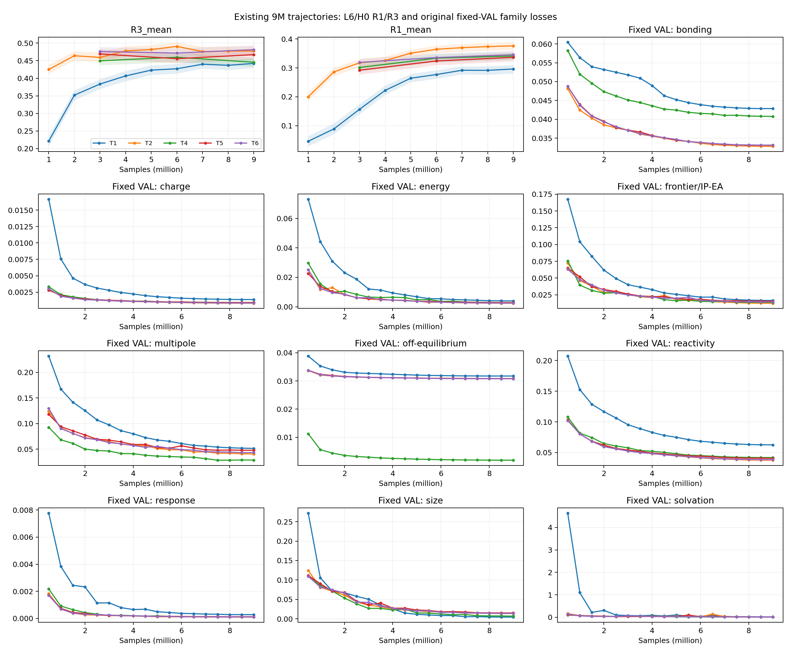

# 9M预算曲线：全部注册点完成

## 9M预算曲线

仅描述同一条9M运行的轨迹，不做胜负判定、不触发seed1或配方修改。各条按自身9M预算cosine退火，3M/6M学习率约为峰值75%/25%，9M到0；中间断点不与已训完的3M筛选运行比较。

[完整精度CSV](../../results/p_recipe/fixed_20261115/confirmation/budget_curve.csv)。固定VAL沿用原生产者每500k记录的各家族损失，未合成未记录的总损失。

| 运行 | 样本/M | R1 [95%CI] | R3 [95%CI] |
| --- | ---: | --- | --- |
| T1 | 1 | 0.046042264 [0.028537496, 0.063065244] | 0.22120746 [0.20635707, 0.23585087] |
| T1 | 2 | 0.088697252 [0.070149636, 0.10714133] | 0.35196072 [0.33695524, 0.36556889] |
| T1 | 3 | 0.15658136 [0.13934319, 0.17344054] | 0.38360589 [0.36936252, 0.39681474] |
| T1 | 4 | 0.22209752 [0.20600612, 0.23849987] | 0.40667904 [0.39133372, 0.42051188] |
| T1 | 5 | 0.26422419 [0.24999533, 0.27880162] | 0.42321463 [0.40897577, 0.43647552] |
| T1 | 6 | 0.2769342 [0.26199864, 0.29180181] | 0.42708313 [0.41320898, 0.44059839] |
| T1 | 7 | 0.2918297 [0.27704868, 0.30476088] | 0.44001781 [0.42710667, 0.4529359] |
| T1 | 8 | 0.29148981 [0.27587758, 0.30549095] | 0.4367874 [0.42322543, 0.45056914] |
| T1 | 9 | 0.29613339 [0.28047053, 0.30983999] | 0.44238549 [0.42889217, 0.45552996] |
| T2 | 1 | 0.20003877 [0.18473633, 0.21518529] | 0.4250582 [0.41199491, 0.43805514] |
| T2 | 2 | 0.28606247 [0.2707095, 0.2999529] | 0.46412713 [0.45013423, 0.47689994] |
| T2 | 3 | 0.31747557 [0.30269646, 0.32980847] | 0.45935112 [0.4454717, 0.47295508] |
| T2 | 4 | 0.32553005 [0.3113321, 0.33860024] | 0.47793779 [0.4657826, 0.49021321] |
| T2 | 5 | 0.3508521 [0.33616371, 0.36300964] | 0.48167599 [0.46890276, 0.49428394] |
| T2 | 6 | 0.36441296 [0.35055824, 0.37601337] | 0.49074932 [0.47737009, 0.50250733] |
| T2 | 7 | 0.36995726 [0.35539413, 0.38228893] | 0.47594969 [0.46153234, 0.48932296] |
| T2 | 8 | 0.3737771 [0.35967337, 0.38642381] | 0.47741904 [0.46379799, 0.49002761] |
| T2 | 9 | 0.37619722 [0.36180767, 0.38873199] | 0.47750045 [0.46363013, 0.49027973] |
| T4 | 3 | 0.30125521 [0.2868446, 0.31525478] | 0.44978253 [0.43693555, 0.46226436] |
| T4 | 6 | 0.33376353 [0.31892138, 0.34750313] | 0.45974242 [0.44559529, 0.47278831] |
| T4 | 9 | 0.34102084 [0.32699858, 0.35428489] | 0.44564481 [0.43261272, 0.45812341] |
| T5 | 3 | 0.29207327 [0.27680191, 0.30592405] | 0.46918876 [0.45595584, 0.48290303] |
| T5 | 6 | 0.323924 [0.3088741, 0.33740721] | 0.45577407 [0.4426546, 0.4689539] |
| T5 | 9 | 0.33656161 [0.32209657, 0.35066766] | 0.46724181 [0.45308798, 0.48067202] |
| T6 | 3 | 0.31906524 [0.30403238, 0.33145394] | 0.47608135 [0.46273407, 0.48873022] |
| T6 | 6 | 0.33568756 [0.32073494, 0.34918991] | 0.47174701 [0.45929624, 0.48492519] |
| T6 | 9 | 0.34545049 [0.32966508, 0.35894198] | 0.48143106 [0.46828659, 0.49368168] |

同断点T2−T1的R1/R3配对Δ及CI见完整表；区间来自原保留配对抽样，不重新bootstrap。

T1：τ=0.022119275，观测断点中从5M之后未见超过τ的后续R3提升。
T1：7M至8M的R3回落，固定VAL中bonding, charge, energy, frontier/IP-EA, multipole, off-equilibrium, reactivity, response, size, solvation家族损失仍下降；仅如实描述，不推断机制，未执行额外诊断。
T2：τ=0.023875022，观测断点中从4M之后未见超过τ的后续R3提升。
T2：2M至3M的R3回落，固定VAL中bonding, charge, energy, frontier/IP-EA, multipole, off-equilibrium, reactivity, response, size家族损失仍下降；仅如实描述，不推断机制，未执行额外诊断。
T2：6M至7M的R3回落，固定VAL中bonding, charge, energy, frontier/IP-EA, multipole, off-equilibrium, reactivity, response, size家族损失仍下降；仅如实描述，不推断机制，未执行额外诊断。
T4：τ=0.02228224，观测断点中从3M之后未见超过τ的后续R3提升。
T4：6M至9M的R3回落，固定VAL中bonding, charge, energy, frontier/IP-EA, multipole, off-equilibrium, reactivity, response, size, solvation家族损失仍下降；仅如实描述，不推断机制，未执行额外诊断。
T5：τ=0.02336209，观测断点中从3M之后未见超过τ的后续R3提升。
T5：3M至6M的R3回落，固定VAL中bonding, charge, energy, frontier/IP-EA, multipole, off-equilibrium, reactivity, response, size, solvation家族损失仍下降；仅如实描述，不推断机制，未执行额外诊断。
T6：τ=0.024071553，观测断点中从3M之后未见超过τ的后续R3提升。
T6：3M至6M的R3回落，固定VAL中bonding, charge, energy, frontier/IP-EA, multipole, off-equilibrium, reactivity, response, size, solvation家族损失仍下降；仅如实描述，不推断机制，未执行额外诊断。

这是观测点上的描述，不证明收敛，也不据此给出机制解释。

