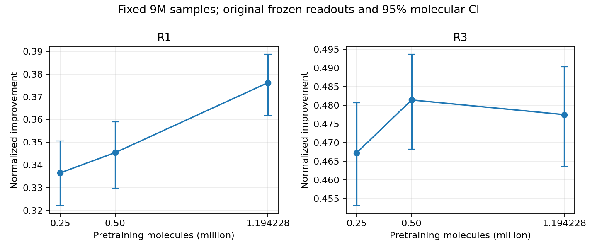

# 原9M确认：主统计完成，最终REPORT仍等待其余补充项

原生产者final_comparisons.close由4539198完成，未调用最终REPORT。旧4538539超时输出与成本保留；恢复前在已恢复健康的node8完整核对本UID仅剩systemd/pam/SSH观察链，没有旧科学进程。旧root身份未记录，不伪造该历史PID。

| 比较 | 读出 | Δ | 95%CI | 原判定 |
| --- | --- | ---: | --- | --- |
| confirmation: fixed_20261115_confirmation_T2 − fixed_20261115_confirmation_T1_sbatch | R3 | 0.03511496 | [0.02254126, 0.04678826] | win |
| confirmation: fixed_20261115_confirmation_T2 − fixed_20261115_confirmation_T1_sbatch | R1 | 0.08006383 | [0.06741304, 0.09225251] | win |
| P_vs_Pprime: fixed_20261115_confirmation_T2 − fixed_20261115_confirmation_T4_sbatch | R3 | 0.03185564 | [0.02216954, 0.04167812] | win |
| P_vs_Pprime: fixed_20261115_confirmation_T2 − fixed_20261115_confirmation_T4_sbatch | R1 | 0.03517638 | [0.02428512, 0.04537848] | win |
| molecule_scaling: fixed_20261115_confirmation_T2 − fixed_20261115_confirmation_T6 | R3 | -0.00393061 | [-0.01315610, 0.00512076] | descriptive |
| molecule_scaling: fixed_20261115_confirmation_T2 − fixed_20261115_confirmation_T6 | R1 | 0.03074673 | [0.01998220, 0.04160375] | descriptive |
| molecule_scaling: fixed_20261115_confirmation_T6 − fixed_20261115_confirmation_T5 | R3 | 0.01418925 | [0.00485710, 0.02331432] | descriptive |
| molecule_scaling: fixed_20261115_confirmation_T6 − fixed_20261115_confirmation_T5 | R1 | 0.00888888 | [-0.00316351, 0.01982697] | descriptive |

[全部26项比较](../../results/p_recipe/fixed_20261115/confirmation/confirmation_registered_comparisons.csv)，其中P与Pprime的18项逐任务比较仅描述。全部是原下游几何；A5未解决，不能用来声称几何已受控。

25万、50万、全量1,194,228分子的重复次数分别36、18、7.5362493594；曲线仅连接观测值，未拟合缩放律，不做扩展决定。

原冻结配方仍是A1+B3+B4+F2；可运行final_recipe.json和PM7_A1/A2/A5、UFF_A1完整精度参数已由原生产者原样导出，未重拟合。I1是另外注册的删项研究，后续采用仍留用户。
