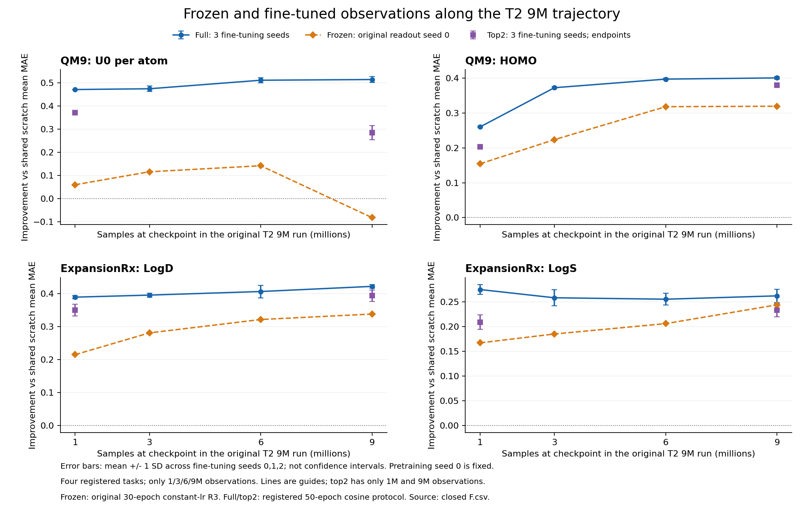

# 原 T2 9M 轨迹：四任务 full／frozen 观测

[矢量 SVG](../../results/p_recipe/fixed_20261115/analysis_20261122/F_T2_full_frozen_trajectories.svg) · [原闭合 F.csv](../../results/p_recipe/fixed_20261115/analysis_20261122/F.csv) · [原预注册解释](../../results/p_recipe/fixed_20261115/analysis_20261122/F1_interpretation.json)

纵轴逐任务使用同一个三种子 scratch 平均 MAE 作参照，即 (E_scratch,mean − E) / E_scratch,mean。full 与 top2 的点和误差条直接取原表的三微调种子均值与标准差；frozen 复用原 R3 读出种子 0。正式的均预测配对 bootstrap CI 保留在原表和主统计中，图的误差条标明为种子标准差。预训练种子固定为 0。

四个注册任务分别画图，原七任务 R3 平均分另查原报告。横轴为原 9M 运行的 1/3/6/9M 中间断点；top2 只有 1M、9M 两点。连线仅辅助阅读，现有观测无法定位恰好 4M 的平台。frozen 沿原 30 轮恒定学习率协议，full/top2 沿注册 50 轮 cosine 协议，图保留这项差异。

绘图仅消费已闭合表中的值；没有新拟合、bootstrap、评价或训练，也不据此改变配方或原判定。
