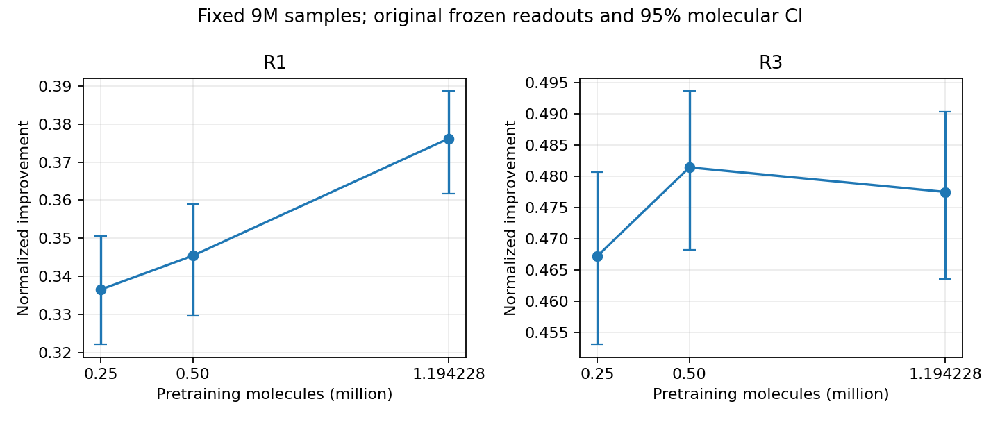
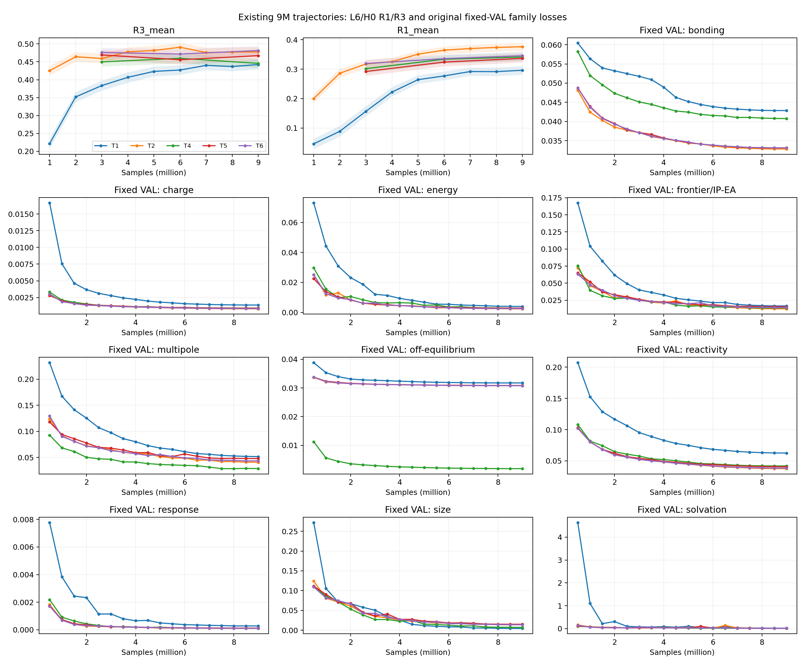
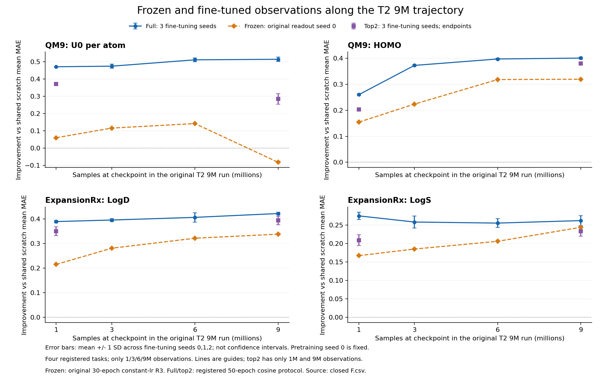

# P 预训练配方研究：最终交付

最终配方为 **T2**，组件：A1, B3, B4, F2。可运行配置：[final_recipe.json](../../configs/p_recipe/fixed_20261115/final_recipe.json)。研究修订：`fixed_20261115`。

| 最终实际batch | 最终学习率 | 逐层重算 | 头 | 配方开关 |
| --- | --- | --- | --- | --- |
| 32 | 0.0003 | False | H1 | {"anti_collapse": true, "element_residual": true, "gamma": 0.1597693323500406, "pma_pooling": true} |

复现此配置时，GPU任务执行训练及原R1/R3读出；`statistics_backend=slurm_cpu`把最终bootstrap交给CPU节点8–19。GPU成功退出后，在CPU节点以同一配置执行`tools/p_recipe/cpu_statistics.py --finalize-configuration <配置路径>`，统计复用已有探针预测和已完成结果。现有队列由登录节点的`collect_execution.py`查询Slurm并派发该CPU后处理；CPU节点上的后处理写出完整R1/R3评分后，本运行才标为COMPLETE。

旧1.5M首轮结论已按用户要求作废，旧第二轮停止；旧输出只作历史记录，未用于本次配方选择。

## 校准及固定设置

用户固定配置：batch=32，lr=0.0003，逐层重算关闭；原三轮及注册第4轮筛选均3,000,000样本，确认9,000,000样本。既有G1按用户要求原样完成并复用为B0，旧裁剪窗口作为明确例外记录。

[完整校准表](../../results/p_recipe/calibration_20261114/calibration.csv)；[逐卡1000步实测吞吐](../../results/p_recipe/calibration_20261114/throughput.csv)。

全量TRAIN为 1,194,228 分子，排除323个重叠分子；VAL为7567。整个研究固定使用 window2_TRAIN_normalization_parameters_20261107_v1，不重拟合基础归一化。主干C1-0：512维、6层、8头、FFN宽2d、FP32、TF32关闭，PM7几何下单独P/clean视图。先均匀抽分子，再均匀抽构象，每分子最多10个构象。P′采用数据方M18前二资格并排除M14留出，包含M17之外的P′专用几何；固定随机采样且资格数不超过k时，从全部合格成员中均匀抽一个，不用普通S′排列截断。

AdamW betas=(0.9,0.95)、wd=0.01；各运行在自己的样本预算内执行完整cosine退火，warmup 2%，种子0。新运行前150000样本以281.7作初始裁剪，按步起点60000≤samples<150000收集裁剪前范数；保持完整32批，在150016样本边界冻结自身p99，此后只报告不调整。标准化标量采用Huber δ=1，向量采用radial_huber_v1。每1000更新记录家族损失，每500k样本在固定2000个VAL分子上记录家族损失，均不用于配方选择。

| 确认运行 | 实际batch | 学习率 | 自身60k–150k范数p99 | 标签/几何 | TRAIN分子数 |
| --- | --- | --- | --- | --- | --- |
| T1 | 32 | 0.0003 | 638.87421 | PM7 | 1194228 |
| T2 | 32 | 0.0003 | 62.154205 | PM7 | 1194228 |
| T4 | 32 | 0.0003 | 47.95916 | UFF | 1192951 |
| T5 | 32 | 0.0003 | 60.122297 | PM7 | 250000 |
| T6 | 32 | 0.0003 | 58.216268 | PM7 | 500000 |

## 放大确认：T1/T2

| 运行 | 组件 | 实际batch/lr | R3主分（seed0） | R1副分（seed0） | VAL家族损失 |
| --- | --- | --- | --- | --- | --- |
| T1 | B0 | 32/0.0003 | 0.44238549 | 0.29613339 | [family_losses.csv](../../results/p_recipe/training/fixed_20261115_confirmation_T1_sbatch/family_losses.csv) |
| T2 | A1, B3, B4, F2 | 32/0.0003 | 0.47750045 | 0.37619722 | [family_losses.csv](../../results/p_recipe/training/fixed_20261115_confirmation_T2/family_losses.csv) |

逐任务单元格为seed0的 R3 / R1；SoM只报告，不进入平均分。9M确认的所有配对判定均只用seed0，不补seed1。

| 任务 | T1 R3/R1 | T2 R3/R1 |
| --- | --- | --- |
| exp.LogD | 0.406306 / 0.29722175 | 0.49665906 / 0.33467064 |
| exp.Log_HLM_CLint | 0.14876516 / 0.062093338 | 0.1977146 / 0.091899441 |
| exp.LogS | 0.25755814 / 0.10906658 | 0.34730264 / 0.15140203 |
| cyp.3A4 | 0.28571429 / 0.375 | 0.23809524 / 0.33333333 |
| cyp.2D6 | 0.125 / 0.125 | 0 / -0.0625 |
| qm9.U0_atom | 0.65419193 / 0.48892022 | 0.50569459 / 0.63445583 |
| qm9.homo | 0.44927942 / 0.27829621 | 0.52884724 / 0.3160644 |
| qm9.lumo | 0.7103704 / 0.55000085 | 0.75508371 / 0.6021163 |
| qm9.alpha | 0.4702274 / 0.28733476 | 0.5112013 / 0.5027719 |

固定2000个VAL分子、最终9M点的标准化家族P损失：

| 家族 | T1 | T2 |
| --- | --- | --- |
| bonding | 0.042859238 | 0.032858025 |
| charge | 0.0013737263 | 0.00080980665 |
| energy | 0.0039859131 | 0.002403251 |
| frontier/IP-EA | 0.016592935 | 0.012440646 |
| multipole | 0.051573165 | 0.04072348 |
| off-equilibrium | 0.031745874 | 0.030819604 |
| reactivity | 0.062602286 | 0.037632215 |
| response | 0.00027691091 | 9.7247986e-05 |
| size | 0.0044033987 | 0.013737176 |
| solvation | 0.017588472 | 0.010440051 |

| 读出 | 任务 | A − B | Δ | 95% CI | 判定 | 证据 |
| --- | --- | --- | --- | --- | --- | --- |
| R3 | MEAN | fixed_20261115_confirmation_T2 − fixed_20261115_confirmation_T1_sbatch | 0.035114957 | [0.022541258, 0.046788262] | win | [deltas.csv](../../results/p_recipe/fixed_20261115/deltas.csv#L42) |
| R1 | MEAN | fixed_20261115_confirmation_T2 − fixed_20261115_confirmation_T1_sbatch | 0.080063832 | [0.067413043, 0.092252507] | win | [deltas.csv](../../results/p_recipe/fixed_20261115/deltas.csv#L43) |

T2按预注册规则胜过T1；配方在9M前已冻结，不追加筛选。

B0与M2的预算同号检查：`{"status": "M2 lacks a separately measured matched configuration at one budget; no extra run", "components": ["A1", "B3", "B4"]}`。

## P与P′对比

P比较臂为 T2，P′为T4，实际共同启用字段 102 个。

原始P/Pprime共同字段 109 个，丢失P字段 0 个（0.000%），T7要求为 False。

| 读出 | 任务 | A − B | Δ | 95% CI | 判定 | 证据 |
| --- | --- | --- | --- | --- | --- | --- |
| R3 | MEAN | fixed_20261115_confirmation_T2 − fixed_20261115_confirmation_T4_sbatch | 0.031855642 | [0.022169538, 0.041678116] | win | [deltas.csv](../../results/p_recipe/fixed_20261115/deltas.csv#L44) |
| R1 | MEAN | fixed_20261115_confirmation_T2 − fixed_20261115_confirmation_T4_sbatch | 0.035176376 | [0.024285119, 0.045378478] | win | [deltas.csv](../../results/p_recipe/fixed_20261115/deltas.csv#L45) |
| R3 | cyp.2D6 | fixed_20261115_confirmation_T2 − fixed_20261115_confirmation_T4_sbatch | -0.25 | [-0.58333333, -0.043478261] | 仅描述 | [deltas.csv](../../results/p_recipe/fixed_20261115/deltas.csv#L50) |
| R3 | cyp.3A4 | fixed_20261115_confirmation_T2 − fixed_20261115_confirmation_T4_sbatch | -0.047619048 | [-0.33333333, 0.21751208] | 仅描述 | [deltas.csv](../../results/p_recipe/fixed_20261115/deltas.csv#L51) |
| R3 | exp.LogD | fixed_20261115_confirmation_T2 − fixed_20261115_confirmation_T4_sbatch | 0.026069584 | [0.0011657345, 0.051220577] | 仅描述 | [deltas.csv](../../results/p_recipe/fixed_20261115/deltas.csv#L52) |
| R3 | exp.LogS | fixed_20261115_confirmation_T2 − fixed_20261115_confirmation_T4_sbatch | 0.040411797 | [0.011493239, 0.071191219] | 仅描述 | [deltas.csv](../../results/p_recipe/fixed_20261115/deltas.csv#L53) |
| R3 | exp.Log_HLM_CLint | fixed_20261115_confirmation_T2 − fixed_20261115_confirmation_T4_sbatch | 0.020456333 | [-0.016773142, 0.058241893] | 仅描述 | [deltas.csv](../../results/p_recipe/fixed_20261115/deltas.csv#L54) |
| R3 | qm9.U0_atom | fixed_20261115_confirmation_T2 − fixed_20261115_confirmation_T4_sbatch | 0.013077804 | [-0.010077643, 0.037910493] | 仅描述 | [deltas.csv](../../results/p_recipe/fixed_20261115/deltas.csv#L55) |
| R3 | qm9.alpha | fixed_20261115_confirmation_T2 − fixed_20261115_confirmation_T4_sbatch | 0.068589384 | [0.045434687, 0.089851968] | 仅描述 | [deltas.csv](../../results/p_recipe/fixed_20261115/deltas.csv#L56) |
| R3 | qm9.homo | fixed_20261115_confirmation_T2 − fixed_20261115_confirmation_T4_sbatch | 0.033975829 | [0.020321634, 0.049612418] | 仅描述 | [deltas.csv](../../results/p_recipe/fixed_20261115/deltas.csv#L57) |
| R3 | qm9.lumo | fixed_20261115_confirmation_T2 − fixed_20261115_confirmation_T4_sbatch | 0.020408766 | [0.011034981, 0.02970277] | 仅描述 | [deltas.csv](../../results/p_recipe/fixed_20261115/deltas.csv#L58) |
| R1 | cyp.2D6 | fixed_20261115_confirmation_T2 − fixed_20261115_confirmation_T4_sbatch | -0.1875 | [-0.58375, 0.0625] | 仅描述 | [deltas.csv](../../results/p_recipe/fixed_20261115/deltas.csv#L59) |
| R1 | cyp.3A4 | fixed_20261115_confirmation_T2 − fixed_20261115_confirmation_T4_sbatch | -0.083333333 | [-0.30443144, 0.15384615] | 仅描述 | [deltas.csv](../../results/p_recipe/fixed_20261115/deltas.csv#L60) |
| R1 | exp.LogD | fixed_20261115_confirmation_T2 − fixed_20261115_confirmation_T4_sbatch | 0.012593509 | [-0.020826979, 0.047163309] | 仅描述 | [deltas.csv](../../results/p_recipe/fixed_20261115/deltas.csv#L61) |
| R1 | exp.LogS | fixed_20261115_confirmation_T2 − fixed_20261115_confirmation_T4_sbatch | 0.019989499 | [-0.010574611, 0.048858321] | 仅描述 | [deltas.csv](../../results/p_recipe/fixed_20261115/deltas.csv#L62) |
| R1 | exp.Log_HLM_CLint | fixed_20261115_confirmation_T2 − fixed_20261115_confirmation_T4_sbatch | 0.0031068417 | [-0.033067471, 0.040057373] | 仅描述 | [deltas.csv](../../results/p_recipe/fixed_20261115/deltas.csv#L63) |
| R1 | qm9.U0_atom | fixed_20261115_confirmation_T2 − fixed_20261115_confirmation_T4_sbatch | 0.070775528 | [0.053299344, 0.088037998] | 仅描述 | [deltas.csv](../../results/p_recipe/fixed_20261115/deltas.csv#L64) |
| R1 | qm9.alpha | fixed_20261115_confirmation_T2 − fixed_20261115_confirmation_T4_sbatch | 0.092852836 | [0.06650058, 0.11513423] | 仅描述 | [deltas.csv](../../results/p_recipe/fixed_20261115/deltas.csv#L65) |
| R1 | qm9.homo | fixed_20261115_confirmation_T2 − fixed_20261115_confirmation_T4_sbatch | 0.02869482 | [0.0074400532, 0.050761956] | 仅描述 | [deltas.csv](../../results/p_recipe/fixed_20261115/deltas.csv#L66) |
| R1 | qm9.lumo | fixed_20261115_confirmation_T2 − fixed_20261115_confirmation_T4_sbatch | 0.018221598 | [0.0042614235, 0.033384715] | 仅描述 | [deltas.csv](../../results/p_recipe/fixed_20261115/deltas.csv#L67) |

## 分子数扩展：固定9M样本

| 分子数 | 运行 | R3主分 | R1副分 | 平均重复次数 |
| --- | --- | --- | --- | --- |
| 250,000 | T5 | 0.46724181 | 0.33656161 | 36 |
| 500,000 | T6 | 0.48143106 | 0.34545049 | 18 |
| 1,194,228 | T2 | 0.47750045 | 0.37619722 | 7.5362494 |

| 读出 | 任务 | A − B | Δ | 95% CI | 判定 | 证据 |
| --- | --- | --- | --- | --- | --- | --- |
| R3 | MEAN | fixed_20261115_confirmation_T2 − fixed_20261115_confirmation_T6 | -0.0039306115 | [-0.013156098, 0.0051207606] | 仅描述 | [deltas.csv](../../results/p_recipe/fixed_20261115/deltas.csv#L46) |
| R1 | MEAN | fixed_20261115_confirmation_T2 − fixed_20261115_confirmation_T6 | 0.030746728 | [0.019982203, 0.04160375] | 仅描述 | [deltas.csv](../../results/p_recipe/fixed_20261115/deltas.csv#L47) |
| R3 | MEAN | fixed_20261115_confirmation_T6 − fixed_20261115_confirmation_T5 | 0.014189252 | [0.0048570977, 0.023314319] | 仅描述 | [deltas.csv](../../results/p_recipe/fixed_20261115/deltas.csv#L48) |
| R1 | MEAN | fixed_20261115_confirmation_T6 − fixed_20261115_confirmation_T5 | 0.0088888807 | [-0.003163514, 0.019826966] | 仅描述 | [deltas.csv](../../results/p_recipe/fixed_20261115/deltas.csv#L49) |

子集种子20261112，250k ⊂ 500k ⊂ 全量。T5/T6及全量缩放点使用seed0，分子数减少会提高重复次数；只作描述，不判胜负、不补种子或作扩量决策。

## 全部筛选臂及组件取舍

## 条件种子比较的实际证据

下表列出每条比较实际使用的seed及原始主副分；两种子比较的点估计为配对差值均值。分子数缩放只使用seed0，逐任务P/Pprime结果亦为seed0描述，不触发额外种子。

| 比较 | A | B | seed | A R3 | B R3 | A R1 | B R1 |
| --- | --- | --- | --- | --- | --- | --- | --- |
| screening / round3 | fixed_20261115_round3_C1_sbatch | fixed_20261115_round3_M2_infra_recovery_20261117_sbatch | 0 | 0.47541131 | 0.46800263 | 0.28629995 | 0.29745473 |
| screening / round3 | fixed_20261115_round3_C2 | fixed_20261115_round3_M2_infra_recovery_20261117_sbatch | 0 | 0.47529602 | 0.46800263 | 0.33908979 | 0.29745473 |
| screening / round3 | fixed_20261115_round3_C3_node20_gpu0_resumed_20261119 | fixed_20261115_round3_M2_infra_recovery_20261117_sbatch | 0 | 0.45629681 | 0.46800263 | 0.25509339 | 0.29745473 |
| screening / round3 | fixed_20261115_round3_C4 | fixed_20261115_round3_M2_infra_recovery_20261117_sbatch | 0 | 0.46419026 | 0.46800263 | 0.35821186 | 0.29745473 |
| merge_rollback / round3 | fixed_20261115_round3_M2_infra_recovery_20261117_sbatch | fixed_20261115_provisional_B_20261116_round2_B3_5090_resumed_20261117 | 0 | 0.46800263 | 0.47450343 | 0.29745473 | 0.3142475 |
| screening / round4 | fixed_20261115_round4_X1 | fixed_20261115_round3_M2_infra_recovery_20261117_sbatch | 0 | 0.45161588 | 0.46800263 | 0.24442051 | 0.29745473 |
| screening / round4 | fixed_20261115_round4_X2 | fixed_20261115_round3_M2_infra_recovery_20261117_sbatch | 0 | 0.47146127 | 0.46800263 | 0.31028355 | 0.29745473 |
| screening / round4 | fixed_20261115_round4_F1 | fixed_20261115_round3_M2_infra_recovery_20261117_sbatch | 0 | 0.46561108 | 0.46800263 | 0.27618851 | 0.29745473 |
| screening / round4 | fixed_20261115_round4_F2 | fixed_20261115_round3_M2_infra_recovery_20261117_sbatch | 0 | 0.47405764 | 0.46800263 | 0.31949262 | 0.29745473 |
| P_vs_Pprime / round4 | fixed_20261115_round4_Pprime | fixed_20261115_round3_M2_infra_recovery_20261117_sbatch | 0 | 0.47074222 | 0.46800263 | 0.28790085 | 0.29745473 |
| confirmation / round0 | fixed_20261115_confirmation_T2 | fixed_20261115_confirmation_T1_sbatch | 0 | 0.47750045 | 0.44238549 | 0.37619722 | 0.29613339 |
| P_vs_Pprime / round0 | fixed_20261115_confirmation_T2 | fixed_20261115_confirmation_T4_sbatch | 0 | 0.47750045 | 0.44564481 | 0.37619722 | 0.34102084 |
| molecule_scaling / round0 | fixed_20261115_confirmation_T2 | fixed_20261115_confirmation_T6 | 0 | 0.47750045 | 0.48143106 | 0.37619722 | 0.34545049 |
| molecule_scaling / round0 | fixed_20261115_confirmation_T6 | fixed_20261115_confirmation_T5 | 0 | 0.48143106 | 0.46724181 | 0.34545049 | 0.33656161 |

| 比较 | A | B | 种子数 | 平均A R3 | 平均B R3 | 平均ΔR3 | 95% CI | 判定 |
| --- | --- | --- | --- | --- | --- | --- | --- | --- |
| screening / round3 | fixed_20261115_round3_C1_sbatch | fixed_20261115_round3_M2_infra_recovery_20261117_sbatch | 1 | 0.47541131 | 0.46800263 | 0.0074086737 | [-0.0027310293, 0.016926544] | tie |
| screening / round3 | fixed_20261115_round3_C2 | fixed_20261115_round3_M2_infra_recovery_20261117_sbatch | 1 | 0.47529602 | 0.46800263 | 0.0072933904 | [-0.0021109316, 0.017003231] | tie |
| screening / round3 | fixed_20261115_round3_C3_node20_gpu0_resumed_20261119 | fixed_20261115_round3_M2_infra_recovery_20261117_sbatch | 1 | 0.45629681 | 0.46800263 | -0.011705819 | [-0.022639167, -0.0012009488] | tie |
| screening / round3 | fixed_20261115_round3_C4 | fixed_20261115_round3_M2_infra_recovery_20261117_sbatch | 1 | 0.46419026 | 0.46800263 | -0.0038123726 | [-0.014107289, 0.0059201071] | tie |
| merge_rollback / round3 | fixed_20261115_round3_M2_infra_recovery_20261117_sbatch | fixed_20261115_provisional_B_20261116_round2_B3_5090_resumed_20261117 | 1 | 0.46800263 | 0.47450343 | -0.0065007987 | [-0.015857518, 0.003274971] | tie |
| screening / round4 | fixed_20261115_round4_X1 | fixed_20261115_round3_M2_infra_recovery_20261117_sbatch | 1 | 0.45161588 | 0.46800263 | -0.016386752 | [-0.027145913, -0.0054216031] | tie |
| screening / round4 | fixed_20261115_round4_X2 | fixed_20261115_round3_M2_infra_recovery_20261117_sbatch | 1 | 0.47146127 | 0.46800263 | 0.0034586384 | [-0.0065467777, 0.013232234] | tie |
| screening / round4 | fixed_20261115_round4_F1 | fixed_20261115_round3_M2_infra_recovery_20261117_sbatch | 1 | 0.46561108 | 0.46800263 | -0.0023915545 | [-0.013084806, 0.0084347996] | tie |
| screening / round4 | fixed_20261115_round4_F2 | fixed_20261115_round3_M2_infra_recovery_20261117_sbatch | 1 | 0.47405764 | 0.46800263 | 0.0060550079 | [-0.0043044535, 0.015516261] | tie |
| P_vs_Pprime / round4 | fixed_20261115_round4_Pprime | fixed_20261115_round3_M2_infra_recovery_20261117_sbatch | 1 | 0.47074222 | 0.46800263 | 0.0027395858 | [-0.0072971351, 0.011631364] | tie |
| confirmation / round0 | fixed_20261115_confirmation_T2 | fixed_20261115_confirmation_T1_sbatch | 1 | 0.47750045 | 0.44238549 | 0.035114957 | [0.022541258, 0.046788262] | win |
| P_vs_Pprime / round0 | fixed_20261115_confirmation_T2 | fixed_20261115_confirmation_T4_sbatch | 1 | 0.47750045 | 0.44564481 | 0.031855642 | [0.022169538, 0.041678116] | win |
| molecule_scaling / round0 | fixed_20261115_confirmation_T2 | fixed_20261115_confirmation_T6 | 1 | 0.47750045 | 0.48143106 | -0.0039306115 | [-0.013156098, 0.0051207606] | descriptive |
| molecule_scaling / round0 | fixed_20261115_confirmation_T6 | fixed_20261115_confirmation_T5 | 1 | 0.48143106 | 0.46724181 | 0.014189252 | [0.0048570977, 0.023314319] | descriptive |

| 轮 | 臂 | ΔR3 | 95% CI | 判定 | 当轮并入 | 证据 |
| --- | --- | --- | --- | --- | --- | --- |
| 1 | A1 | 0.053769827 | [0.042061955, 0.067014431] | win | 是 | [deltas.csv](../../results/p_recipe/fixed_20261115/deltas.csv#L2) |
| 1 | A2 | -0.076645826 | [-0.09041057, -0.063327523] | loss | 否 | [deltas.csv](../../results/p_recipe/fixed_20261115/deltas.csv#L4) |
| 1 | A3 | 0.0012432125 | [-0.011841071, 0.014881568] | tie | 否 | [deltas.csv](../../results/p_recipe/fixed_20261115/deltas.csv#L6) |
| 1 | A4 | 0.014703035 | [0.0022745158, 0.027045955] | tie | 否 | [deltas.csv](../../results/p_recipe/fixed_20261115/deltas.csv#L8) |
| 1 | A5 | -0.035709218 | [-0.078043307, -0.0099558829] | loss | 否 | [deltas.csv](../../results/p_recipe/fixed_20261115/deltas.csv#L10) |
| 2 | B1 | -0.057029018 | [-0.068755388, -0.045081133] | loss | 否 | [deltas.csv](../../results/p_recipe/fixed_20261115/deltas.csv#L12) |
| 2 | B2 | 0.030105465 | [0.018459061, 0.042951131] | win | 否 | [deltas.csv](../../results/p_recipe/fixed_20261115/deltas.csv#L14) |
| 2 | B3 | 0.11506217 | [0.10380505, 0.12791136] | win | 是 | [deltas.csv](../../results/p_recipe/fixed_20261115/deltas.csv#L16) |
| 2 | B4 | 0.020597338 | [0.0037567646, 0.035645199] | win | 是 | [deltas.csv](../../results/p_recipe/fixed_20261115/deltas.csv#L18) |
| 3 | C1 | 0.0074086737 | [-0.0027310293, 0.016926544] | tie | 否 | [deltas.csv](../../results/p_recipe/fixed_20261115/deltas.csv#L22) |
| 3 | C2 | 0.0072933904 | [-0.0021109316, 0.017003231] | tie | 否 | [deltas.csv](../../results/p_recipe/fixed_20261115/deltas.csv#L24) |
| 3 | C3 | -0.011705819 | [-0.022639167, -0.0012009488] | tie | 否 | [deltas.csv](../../results/p_recipe/fixed_20261115/deltas.csv#L26) |
| 3 | C4 | -0.0038123726 | [-0.014107289, 0.0059201071] | tie | 否 | [deltas.csv](../../results/p_recipe/fixed_20261115/deltas.csv#L28) |
| 4 | X1 | -0.016386752 | [-0.027145913, -0.0054216031] | tie | 否 | [deltas.csv](../../results/p_recipe/fixed_20261115/deltas.csv#L32) |
| 4 | X2 | 0.0034586384 | [-0.0065467777, 0.013232234] | tie | 否 | [deltas.csv](../../results/p_recipe/fixed_20261115/deltas.csv#L34) |
| 4 | F1 | -0.0023915545 | [-0.013084806, 0.0084347996] | tie | 否 | [deltas.csv](../../results/p_recipe/fixed_20261115/deltas.csv#L36) |
| 4 | F2 | 0.0060550079 | [-0.0043044535, 0.015516261] | tie | 是 | [deltas.csv](../../results/p_recipe/fixed_20261115/deltas.csv#L38) |
| 4 | PP | 0.0027395858 | [-0.0072971351, 0.011631364] | tie | 数据来源比较，不并入配方 | [deltas.csv](../../results/p_recipe/fixed_20261115/deltas.csv#L40) |

合并、冲突与停止记录：

| 轮 | 合并组件 | 合并回退 | 累计筛选GPUh | 停止原因 |
| --- | --- | --- | --- | --- |
| 1 | A1 | False | 131.92422 | 继续下一轮 |
| 2 | A1, B3, B4 | True | 185.63318 | 继续下一轮 |
| 3 | A1, B3, B4 | False | 303.5831 | 继续下一轮 |
| 4 | A1, B3, B4, F2 | False | 361.38334 | 注册第4轮及所需合并比较完成 |

## 第4轮：扰动信号、多保真度及3M P/Pprime

字段配对、未配对原因和P/Pprime交集：[ROUND4_METHODS.md](ROUND4_METHODS.md)。本轮每条3M，以M2为基线；按11-19指示，仅seed0 WIN补seed1，真实训练问题例外另记，最多两个种子。PP单独比较数据来源，不作为配方组件。

X1/F2平局时，仅在R3的CI包含0时采纳更简单的去掉项；CI整体为负时保留原项。X2/F1平局不采纳。X1/X2、F1/F2互斥，按Δ较大项取舍。下表保留原始胜负判定，最终并入项同时受M3合并比较约束。

| PP运行 | 对照运行 | R3 Δ | 95% CI | 最小效应 | M2两种子R3差 | 9M-T4决定 |
| --- | --- | --- | --- | --- | --- | --- |
| fixed_20261115_round4_Pprime | fixed_20261115_round3_M2_infra_recovery_20261117_sbatch | 0.0027395858 | [-0.0072971351, 0.011631364] | 0.023537111 | 0.0020471782 | KEEP |

按18B预授权，PP的CI不含0、|Δ|达到最小效应且超过M2两种子R3差时，自动省略9M-T4；否则保留。

| M3组件 | 第4轮候选 | 需3M合并比较 | 最终组件 | 合并验证完成 |
| --- | --- | --- | --- | --- |
| A1, B3, B4 | F2 | False | A1, B3, B4, F2 | True |

## 最终配方冻结与侧线交接

第4轮为最后一轮筛选。两条侧线按各自原预注册规则产生的两种子胜出项直接合并；未完成者按记录的最终未解决处置不并入。本线不重判侧线、不另开验证轮；head类型线已规定的自身确认仍由该线完成。9M在全部判定与合并后冻结配方，T3/T7取消。

| 线路 | 最终状态 | 并入组件 | 证据 |
| --- | --- | --- | --- |
| heads | COMPLETE_FOR_RECIPE_NO_WINNERS_USER_20261119 | 无 | [正式判定](https://github.com/mint258/MFM/blob/p-heads-20261117/docs/p_heads/USER_DIRECTIVE_20261119.md) |
| decoupling | COMPLETE_TWO_SEEDS | 无 | [正式判定](https://github.com/mint258/MFM/blob/p-followup-20261116/docs/p_followup/FINAL_REPORT.md) |

| 线路 | 臂 | 种子数 | 原平均Δ | 原各种子CI | 原判定 | 并入 | 证据 |
| --- | --- | --- | --- | --- | --- | --- | --- |
| heads | T1 | 2 | — | [[-0.007078817581392126, 0.014793625130516982], [-0.012367245104910263, 0.007547898029821682]] | tie | 否 | [正式判定](https://github.com/mint258/MFM/blob/p-heads-20261117/results/p_heads/T/T1_deltas.json) |
| heads | T2 | 2 | — | [[-0.016785810164422956, 0.0020004774800213097], [-0.009372422341078549, 0.011136945517705965]] | tie | 否 | [正式判定](https://github.com/mint258/MFM/blob/p-heads-20261117/results/p_heads/T/T2_deltas.json) |
| heads | T3 | 2 | — | [[-0.032053393575519645, -0.012058970924839008], [-0.018908726064840085, -5.651925868087425e-05]] | loss | 否 | [正式判定](https://github.com/mint258/MFM/blob/p-heads-20261117/results/p_heads/T/T3_deltas.json) |
| heads | T4 | 2 | — | [[-0.03329311920502372, -0.012381142009745813], [-0.0004768960235272762, 0.018201008294255163]] | tie | 否 | [正式判定](https://github.com/mint258/MFM/blob/p-heads-20261117/results/p_heads/T/T4_deltas.json) |
| decoupling | Dprime | 2 | -0.038428696 | [[-0.05626819574608201, -0.034293740123209175], [-0.04243675973173937, -0.021103425065180016]] | loss | 否 | [正式判定](https://github.com/mint258/MFM/blob/p-followup-20261116/docs/p_followup/DPRIME_M2_COMPARISON.md) |

## 评价及统计方法

计分任务为ExpansionRx的LogD、LogS、HLM CLint，以及QM9原子化能、alpha、homo、lumo。原子化能为U0减去QM9官方U0原子参考之和。CYP3A4/2D6 SoM只报告。R1为mean(H)上的ridge；R3为原子MLP后拼接mean与sum/N_ref再经MLP，下游均读取最终第6层、共享投影器之前的H。

特征标准化前剔除TRAIN标准差低于max(1e-12,1e-4×各维标准差中位数)的维度。R3探针TRAIN按分子90/10切分，种子20261112；仅90%上训练30epoch，以内部10%最低误差选epoch，不在100%重训。探针AdamW lr1e-3、wd0.01、batch32、种子0。E_ref为同协议、同读出的随机C1-0误差，单任务分数(E_ref−E)/E_ref。E_ref低于0.05倍标签标准差的任务剔出平均，具体去除标记保留于scores.csv。

主分为有效计分任务R3均值，副分为R1均值。按分子配对bootstrap1000次，种子20261025，取95%百分位区间。A胜B需ΔR3区间下界>0且Δ≥max(0.01,0.05×max(score_A,score_B))；否则按对称规则判负或平局，平局取更简单配置。R1仅报告；R3胜且R1负仍采纳。每轮仅与当轮基线比较，B2/B3及C1/C2冲突时保留Δ较大项；合并基线若输给前轮最佳单项则回退。200GPUh筛选上限已按2026-11-17用户补充指示取消。第4轮由11-18指示注册，X1/X2/F1/F2对照M2；M3不同于M2时，新增组件须经M3上的3M合并比较胜出后采纳。旧作废筛选、测速及校准成本不混入新筛选预算。M2 seed1作为噪声描述及已有配对参考供各线复用，不重训对照。11-19起3M筛选仅seed0 WIN补seed1，真实训练问题例外另记；全部9M只用seed0，不补任何种子。两种子点估计取配对Δ均值，各自原1000个分子bootstrap差值等权拼接为2000个差值，取95%分位CI；阈值使用两种子平均分，原胜负规则不变。R1及逐任务结果只报告，不额外触发训练。

## A1/A2/A5定义及TRAIN拟合参数

A1对尚未扣元素参考的广延分子标量拟合y≈Σc_Z n_Z+b，训练目标取残差；已扣参考的字段不重复扣。A2对注册表中相同物理量、同分子/原子/分量取状态值减中性值，且两者掩码均有效；反变换加回中性值。A5取t=sign(r)·log1p(|r|/m)，反变换为r=sign(t)·m·expm1(|t|)，m为TRAIN绝对目标中位数，r先按既有元素参考/已采纳变换处理。组合顺序为状态差、元素参考、重尾、标准化，逆序反变换后报告原单位。

拟合使用清洁TRAIN，种子20261112，默认128000分子，A1每字段至少100000有效分子。最小二乘、参考扣除和组合变换采用FP64，模型目标为FP32。向量零中心、同头各分量共用模长的总体标准差；重尾向量各分量共用m。下表系数便于阅读，链接JSON保存完整精度及所有对应关系。

### PM7_A1

完整精度参数：[PM7_A1.json](../../configs/p_recipe/label_parameters/PM7_A1.json)。拟合角色 TRAIN，分子数 128000，随机种子 20261112。

| A1字段 | 有效分子 | 元素系数（按原子序数） | 截距 | 中心 | 尺度 |
| --- | --- | --- | --- | --- | --- |
| P.pm7_B.r42.value | 128000 | Z1:2.42671958448, Z5:8.005991085, Z6:8.86868062662, Z7:9.35011838099, Z8:7.02648597456, Z9:7.22027126055, Z14:13.5238904211, Z15:4.13272167559, Z16:18.1918710286, Z17:15.0934763594, Z34:14.2531634693, Z35:21.0020232613, Z53:26.1081157213 | 85.7712862137 | -5.343459e-14 | 26.914509 |
| P.pm7_B.r43.value | 128000 | Z1:4.57211301483, Z5:14.1689713711, Z6:12.3930352702, Z7:11.9453922351, Z8:11.3414528296, Z9:12.5601750669, Z14:34.210825755, Z15:27.827034781, Z16:27.5130327159, Z17:26.2856288782, Z34:33.3522037096, Z35:34.5592975631, Z53:45.2759473662 | 6.36195052204 | -1.3444268e-13 | 8.8889783 |
| P.pm7_anion.r193.value | 128000 | Z1:2.42671958448, Z5:8.005991085, Z6:8.86868062662, Z7:9.35011838099, Z8:7.02648597456, Z9:7.22027126055, Z14:13.5238904211, Z15:4.13272167559, Z16:18.1918710286, Z17:15.0934763594, Z34:14.2531634693, Z35:21.0020232613, Z53:26.1081157213 | 85.7712862137 | -5.343459e-14 | 26.914509 |
| P.pm7_anion.r194.value | 128000 | Z1:4.57211301483, Z5:14.1689713711, Z6:12.3930352702, Z7:11.9453922351, Z8:11.3414528296, Z9:12.5601750669, Z14:34.210825755, Z15:27.827034781, Z16:27.5130327159, Z17:26.2856288782, Z34:33.3522037096, Z35:34.5592975631, Z53:45.2759473662 | 6.36195052204 | -1.3444268e-13 | 8.8889783 |
| P.pm7_cation.r262.value | 127995 | Z1:2.42522111134, Z5:8.00807821075, Z6:8.86971814551, Z7:9.34936166617, Z8:7.01650887162, Z9:7.21819155614, Z14:13.5252950265, Z15:4.13698301949, Z16:18.1811463415, Z17:15.0888007466, Z34:14.2337469281, Z35:20.9956260296, Z53:26.1045871963 | 85.8238381369 | -2.9858705e-13 | 26.91134 |
| P.pm7_cation.r263.value | 127995 | Z1:4.57152735022, Z5:14.1693611643, Z6:12.3939071249, Z7:11.9447772453, Z8:11.3400889576, Z9:12.5594433227, Z14:34.2134390188, Z15:27.8338678323, Z16:27.5100444939, Z17:26.284118011, Z34:33.3478360622, Z35:34.5572120861, Z53:45.274273902 | 6.3653539121 | -2.9870163e-13 | 8.8880108 |
| P.pm7_octanol.r329.value | 128000 | Z1:2.42664124542, Z5:8.00653288301, Z6:8.86865397912, Z7:9.35006848895, Z8:7.02652070021, Z9:7.22018283174, Z14:13.5236057008, Z15:4.13263313195, Z16:18.1921401497, Z17:15.0932443917, Z34:14.2525389721, Z35:21.0015491272, Z53:26.1141839238 | 85.7719445293 | -8.5744745e-15 | 26.914568 |
| P.pm7_octanol.r330.value | 128000 | Z1:4.57199678714, Z5:14.1697968, Z6:12.392905689, Z7:11.9454061134, Z8:11.3414094797, Z9:12.5601867089, Z14:34.2101883524, Z15:27.8274367961, Z16:27.5135068979, Z17:26.2854535277, Z34:33.3518242408, Z35:34.5583093286, Z53:45.2796654721 | 6.36363181145 | -3.8622883e-14 | 8.8884991 |
| P.pm7_water.r396.value | 128000 | Z1:2.42664124542, Z5:8.00653288301, Z6:8.86865397912, Z7:9.35006848895, Z8:7.02652070021, Z9:7.22018283174, Z14:13.5236057008, Z15:4.13263313195, Z16:18.1921401497, Z17:15.0932443917, Z34:14.2525389721, Z35:21.0015491272, Z53:26.1141839238 | 85.7719445293 | -8.5744745e-15 | 26.914568 |
| P.pm7_water.r397.value | 128000 | Z1:4.57199678714, Z5:14.1697968, Z6:12.392905689, Z7:11.9454061134, Z8:11.3414094797, Z9:12.5601867089, Z14:34.2101883524, Z15:27.8274367961, Z16:27.5135068979, Z17:26.2854535277, Z34:33.3518242408, Z35:34.5583093286, Z53:45.2796654721 | 6.36363181145 | -3.8622883e-14 | 8.8884991 |
| P.xtb_fod.r538.value | 128000 | Z1:-0.0151050587782, Z5:0.0383222959211, Z6:0.0256804230658, Z7:0.0334927356661, Z8:0.00318891555202, Z9:-0.012571744049, Z14:0.074963035982, Z15:0.0449350375911, Z16:0.0565110318338, Z17:-0.00664437934245, Z34:0.111654704942, Z35:0.0377709054091, Z53:0.0492278948271 | 0.0153937243481 | 3.1578906e-16 | 0.13340821 |

### PM7_A2

完整精度参数：[PM7_A2.json](../../configs/p_recipe/label_parameters/PM7_A2.json)。拟合角色 TRAIN，分子数 128000，随机种子 20261112。

| A2状态字段 | 对应中性字段 | 中心 | 尺度 |
| --- | --- | --- | --- |
| P.pm7_anion.r190.p | P.pm7_B.r39.p | 0.014155319 | 0.062735642 |
| P.pm7_anion.r190.s | P.pm7_B.r39.s | 0.0042478091 | 0.019403973 |
| P.pm7_anion.r196.x | P.pm7_B.r52.x | 0 | 8.0542421 |
| P.pm7_anion.r196.y | P.pm7_B.r52.y | 0 | 8.0542421 |
| P.pm7_anion.r196.z | P.pm7_B.r52.z | 0 | 8.0542421 |
| P.pm7_anion.r204.value | P.pm7_B.r60.value | 0.16394527 | 12.935118 |
| P.pm7_anion.r210.value | P.pm7_B.r68.value | -0.018909529 | 0.060068807 |
| P.pm7_cation.r259.p | P.pm7_B.r39.p | -0.013882505 | 0.068845199 |
| P.pm7_cation.r259.s | P.pm7_B.r39.s | -0.0051217189 | 0.018488239 |
| P.pm7_cation.r265.x | P.pm7_B.r52.x | 0 | 7.5107015 |
| P.pm7_cation.r265.y | P.pm7_B.r52.y | 0 | 7.5107015 |
| P.pm7_cation.r265.z | P.pm7_B.r52.z | 0 | 7.5107015 |
| P.pm7_cation.r273.value | P.pm7_B.r60.value | 0.16199031 | 12.15218 |
| P.pm7_cation.r279.value | P.pm7_B.r68.value | 0.018910933 | 0.067533145 |
| P.pm7_octanol.r326.p | P.pm7_B.r39.p | 0.0037532628 | 0.020478237 |
| P.pm7_octanol.r326.s | P.pm7_B.r39.s | -0.00370921 | 0.0070285614 |
| P.pm7_octanol.r332.x | P.pm7_B.r52.x | 0 | 0.76509118 |
| P.pm7_octanol.r332.y | P.pm7_B.r52.y | 0 | 0.76509118 |
| P.pm7_octanol.r332.z | P.pm7_B.r52.z | 0 | 0.76509118 |
| P.pm7_octanol.r340.value | P.pm7_B.r60.value | 0.021090267 | 3.0831492 |
| P.pm7_octanol.r346.value | P.pm7_B.r68.value | 5.6210126e-11 | 0.021839922 |
| P.pm7_water.r393.p | P.pm7_B.r39.p | 0.0043648774 | 0.024220532 |
| P.pm7_water.r393.s | P.pm7_B.r39.s | -0.0043148748 | 0.0082659747 |
| P.pm7_water.r399.x | P.pm7_B.r52.x | 0 | 0.92960072 |
| P.pm7_water.r399.y | P.pm7_B.r52.y | 0 | 0.92960072 |
| P.pm7_water.r399.z | P.pm7_B.r52.z | 0 | 0.92960072 |
| P.pm7_water.r407.value | P.pm7_B.r60.value | 0.02509655 | 3.6508482 |
| P.pm7_water.r413.value | P.pm7_B.r68.value | 1.2162158e-10 | 0.025761106 |
| P.xtb_ALPB_octanol.r460.value | P.xtb_singlepoint.r670.value | 1.0071654e-05 | 0.0036543308 |
| P.xtb_ALPB_water.r499.value | P.xtb_singlepoint.r670.value | 1.8225451e-05 | 0.0048887081 |

### PM7_A5

完整精度参数：[PM7_A5.json](../../configs/p_recipe/label_parameters/PM7_A5.json)。拟合角色 TRAIN，分子数 128000，随机种子 20261112。

| A5字段 | m | 先扣元素参考 | 中心 | 尺度 |
| --- | --- | --- | --- | --- |
| P.pm7_B.r41.value | 1991.58341138 | 是 | 0.010293443 | 0.8995323 |
| P.pm7_B.r54.value | 1991.63046671 | 是 | -0.010291197 | 0.89951504 |
| P.pm7_cation.r265.x | 4.0920009613 | 否 | 0 | 0.54024068 |
| P.pm7_cation.r265.y | 4.0920009613 | 否 | 0 | 0.54024068 |
| P.pm7_cation.r265.z | 4.0920009613 | 否 | 0 | 0.54024068 |

### UFF_A1

完整精度参数：[UFF_A1.json](../../configs/p_recipe/label_parameters/UFF_A1.json)。拟合角色 TRAIN，分子数 128000，随机种子 20261112。

| A1字段 | 有效分子 | 元素系数（按原子序数） | 截距 | 中心 | 尺度 |
| --- | --- | --- | --- | --- | --- |
| P.pm7_B.r42.value | 128000 | Z1:2.23357273335, Z5:5.00338299377, Z6:8.8204984982, Z7:9.21817554107, Z8:7.97079123769, Z9:7.36299904301, Z14:12.2242581609, Z15:9.1153390472, Z16:14.9208422043, Z17:15.939067082, Z34:12.8458847328, Z35:20.7922979519, Z53:28.7260227804 | 92.7452200621 | -2.5219293e-13 | 24.836723 |
| P.pm7_B.r43.value | 128000 | Z1:4.7439701184, Z5:14.9167062216, Z6:12.5517983248, Z7:12.1183141467, Z8:12.421483603, Z9:13.1472716873, Z14:29.8719683061, Z15:25.0604733845, Z16:27.4197925231, Z17:28.8730036846, Z34:34.090241378, Z35:35.6929256316, Z53:45.8263975094 | 1.67487353945 | -2.605729e-13 | 8.995176 |
| P.pm7_anion.r193.value | 127998 | Z1:2.23596482214, Z5:5.02961660631, Z6:8.81894387746, Z7:9.24455605474, Z8:7.99605589358, Z9:7.36758904471, Z14:12.2465040178, Z15:9.08210062593, Z16:14.9730903617, Z17:15.9487475092, Z34:12.9132151789, Z35:20.8131704043, Z53:28.7461852543 | 92.5483976162 | -2.7861527e-13 | 24.789919 |
| P.pm7_anion.r194.value | 127998 | Z1:4.7437818202, Z5:14.9164398474, Z6:12.5521122884, Z7:12.1173407003, Z8:12.4202662389, Z9:13.1469660734, Z14:29.8725221904, Z15:25.0614952771, Z16:27.4185076764, Z17:28.8723601419, Z34:34.0880485682, Z35:35.6918442374, Z53:45.8253139508 | 1.67974632043 | -1.5696312e-13 | 8.9947692 |
| P.pm7_cation.r262.value | 127996 | Z1:2.23514004172, Z5:5.03419102612, Z6:8.82059608027, Z7:9.24505717642, Z8:7.99428183395, Z9:7.36661845461, Z14:12.2547807047, Z15:9.08360853876, Z16:14.9745065006, Z17:15.9467949559, Z34:12.891119817, Z35:20.8112144391, Z53:28.6949263002 | 92.5376266856 | -3.9980647e-13 | 24.791406 |
| P.pm7_cation.r263.value | 127996 | Z1:4.74400637107, Z5:14.9153982802, Z6:12.5517117788, Z7:12.1172087383, Z8:12.420720317, Z9:13.1472195845, Z14:29.8706357404, Z15:25.060739172, Z16:27.4186320194, Z17:28.8728589211, Z34:34.096830992, Z35:35.6923483503, Z53:45.8429192778 | 1.68144454741 | -4.7359242e-13 | 8.9948338 |
| P.pm7_octanol.r329.value | 128000 | Z1:2.23350094175, Z5:5.00303629459, Z6:8.82047795775, Z7:9.21817266703, Z8:7.9707856027, Z9:7.36290897661, Z14:12.2244370742, Z15:9.11514854884, Z16:14.920874653, Z17:15.9389845534, Z34:12.8457091923, Z35:20.7917929786, Z53:28.7259011198 | 92.7452284938 | -2.737508e-13 | 24.836694 |
| P.pm7_octanol.r330.value | 128000 | Z1:4.74386783976, Z5:14.9162644485, Z6:12.5516460311, Z7:12.1181973573, Z8:12.4212698152, Z9:13.147062437, Z14:29.8714620122, Z15:25.0595314642, Z16:27.4194037957, Z17:28.8726461016, Z34:34.0894001771, Z35:35.6925231707, Z53:45.8258822752 | 1.677277909 | -1.4479973e-14 | 8.9949306 |
| P.pm7_water.r396.value | 128000 | Z1:2.23350094175, Z5:5.00303629459, Z6:8.82047795775, Z7:9.21817266703, Z8:7.9707856027, Z9:7.36290897661, Z14:12.2244370742, Z15:9.11514854884, Z16:14.920874653, Z17:15.9389845534, Z34:12.8457091923, Z35:20.7917929786, Z53:28.7259011198 | 92.7452284938 | -2.737508e-13 | 24.836694 |
| P.pm7_water.r397.value | 128000 | Z1:4.74386783976, Z5:14.9162644485, Z6:12.5516460311, Z7:12.1181973573, Z8:12.4212698152, Z9:13.147062437, Z14:29.8714620122, Z15:25.0595314642, Z16:27.4194037957, Z17:28.8726461016, Z34:34.0894001771, Z35:35.6925231707, Z53:45.8258822752 | 1.677277909 | -1.4479973e-14 | 8.9949306 |
| P.xtb_fod.r538.value | 128000 | Z1:-0.0180116730694, Z5:0.0837681097918, Z6:0.0291353347393, Z7:0.044306897036, Z8:0.0129648466718, Z9:-0.0140726292828, Z14:0.0840304774067, Z15:0.0627802934747, Z16:0.0611895783758, Z17:-0.00743650258692, Z34:0.123159791047, Z35:0.0387227682144, Z53:0.0528722580065 | 0.0297123313404 | -6.4972333e-16 | 0.17452143 |

## 资源与成本

[完整成本及历史会计口径](COST.md)；[本次最终成本明细](../../results/p_recipe/fixed_20261115/cost_current.json)。

GPU时间按实际原生运行及Slurm执行区间记账，保留失败与取消成本，完整状态接管的重叠区间不重复计入；CPU拟合、统计、测试和导出另列。历史缺失区间和耗时下界仍按原记录报告，不将未知成本当作零。

| 确认卡型 | 实测样本/秒 | 整卡平均功耗/W | 功耗采样数 |
| --- | --- | --- | --- |
| 5090 | 62.639239 | 475.51768 | 4774 |
| 4090 | 72.149814 | 295.90136 | 8295 |
| 3090 | 69.639516 | 313.78236 | 8607 |

[原自然训练遥测汇总](../../results/p_recipe/fixed_20261115/hardware_confirmation.csv)。功耗为整卡采样均值、包含共用上下文；各配方和共用条件不同，不据此作卡型的因果比较，未额外运行GPU测速。

## 最终交付标识

最终代码提交：`94d533d27b107cc24d07438135e48dfb75dcd24f`。

已保留的P′及分子数运行采用T2的最终合并配方。Not applicable:18B cancels T3; no post-closeout training。

闭合P0证据：[P0_SUMMARY.md](P0_SUMMARY.md)；完整任务评分：[scores.csv](../../results/p_recipe/scores.csv)；本修订配对比较：[deltas.csv](../../results/p_recipe/fixed_20261115/deltas.csv)。

## 9M预算曲线

仅描述同一条9M运行的轨迹，不做胜负判定、不触发seed1或配方修改。各条按自身9M预算cosine退火，3M/6M学习率约为峰值75%/25%，9M到0；中间断点不与已训完的3M筛选运行比较。

[完整精度CSV](../../results/p_recipe/fixed_20261115/confirmation/budget_curve.csv)。固定VAL沿用原生产者每500k记录的各家族损失，未合成未记录的总损失。

| 运行 | 样本/M | R1 [95%CI] | R3 [95%CI] |
| --- | ---: | --- | --- |
| T1 | 1 | 0.046042264 [0.028537496, 0.063065244] | 0.22120746 [0.20635707, 0.23585087] |
| T1 | 2 | 0.088697252 [0.070149636, 0.10714133] | 0.35196072 [0.33695524, 0.36556889] |
| T1 | 3 | 0.15658136 [0.13934319, 0.17344054] | 0.38360589 [0.36936252, 0.39681474] |
| T1 | 4 | 0.22209752 [0.20600612, 0.23849987] | 0.40667904 [0.39133372, 0.42051188] |
| T1 | 5 | 0.26422419 [0.24999533, 0.27880162] | 0.42321463 [0.40897577, 0.43647552] |
| T1 | 6 | 0.2769342 [0.26199864, 0.29180181] | 0.42708313 [0.41320898, 0.44059839] |
| T1 | 7 | 0.2918297 [0.27704868, 0.30476088] | 0.44001781 [0.42710667, 0.4529359] |
| T1 | 8 | 0.29148981 [0.27587758, 0.30549095] | 0.4367874 [0.42322543, 0.45056914] |
| T1 | 9 | 0.29613339 [0.28047053, 0.30983999] | 0.44238549 [0.42889217, 0.45552996] |
| T2 | 1 | 0.20003877 [0.18473633, 0.21518529] | 0.4250582 [0.41199491, 0.43805514] |
| T2 | 2 | 0.28606247 [0.2707095, 0.2999529] | 0.46412713 [0.45013423, 0.47689994] |
| T2 | 3 | 0.31747557 [0.30269646, 0.32980847] | 0.45935112 [0.4454717, 0.47295508] |
| T2 | 4 | 0.32553005 [0.3113321, 0.33860024] | 0.47793779 [0.4657826, 0.49021321] |
| T2 | 5 | 0.3508521 [0.33616371, 0.36300964] | 0.48167599 [0.46890276, 0.49428394] |
| T2 | 6 | 0.36441296 [0.35055824, 0.37601337] | 0.49074932 [0.47737009, 0.50250733] |
| T2 | 7 | 0.36995726 [0.35539413, 0.38228893] | 0.47594969 [0.46153234, 0.48932296] |
| T2 | 8 | 0.3737771 [0.35967337, 0.38642381] | 0.47741904 [0.46379799, 0.49002761] |
| T2 | 9 | 0.37619722 [0.36180767, 0.38873199] | 0.47750045 [0.46363013, 0.49027973] |
| T4 | 3 | 0.30125521 [0.2868446, 0.31525478] | 0.44978253 [0.43693555, 0.46226436] |
| T4 | 6 | 0.33376353 [0.31892138, 0.34750313] | 0.45974242 [0.44559529, 0.47278831] |
| T4 | 9 | 0.34102084 [0.32699858, 0.35428489] | 0.44564481 [0.43261272, 0.45812341] |
| T5 | 3 | 0.29207327 [0.27680191, 0.30592405] | 0.46918876 [0.45595584, 0.48290303] |
| T5 | 6 | 0.323924 [0.3088741, 0.33740721] | 0.45577407 [0.4426546, 0.4689539] |
| T5 | 9 | 0.33656161 [0.32209657, 0.35066766] | 0.46724181 [0.45308798, 0.48067202] |
| T6 | 3 | 0.31906524 [0.30403238, 0.33145394] | 0.47608135 [0.46273407, 0.48873022] |
| T6 | 6 | 0.33568756 [0.32073494, 0.34918991] | 0.47174701 [0.45929624, 0.48492519] |
| T6 | 9 | 0.34545049 [0.32966508, 0.35894198] | 0.48143106 [0.46828659, 0.49368168] |

同断点T2−T1的R1/R3配对Δ及CI见完整表；区间来自原保留配对抽样，不重新bootstrap。

T1：τ=0.022119275，观测断点中从5M之后未见超过τ的后续R3提升。
T1：7M至8M的R3回落，固定VAL中bonding, charge, energy, frontier/IP-EA, multipole, off-equilibrium, reactivity, response, size, solvation家族损失仍下降；仅如实描述，不推断机制，未执行额外诊断。
T2：τ=0.023875022，观测断点中从4M之后未见超过τ的后续R3提升。
T2：2M至3M的R3回落，固定VAL中bonding, charge, energy, frontier/IP-EA, multipole, off-equilibrium, reactivity, response, size家族损失仍下降；仅如实描述，不推断机制，未执行额外诊断。
T2：6M至7M的R3回落，固定VAL中bonding, charge, energy, frontier/IP-EA, multipole, off-equilibrium, reactivity, response, size家族损失仍下降；仅如实描述，不推断机制，未执行额外诊断。
T4：τ=0.02228224，观测断点中从3M之后未见超过τ的后续R3提升。
T4：6M至9M的R3回落，固定VAL中bonding, charge, energy, frontier/IP-EA, multipole, off-equilibrium, reactivity, response, size, solvation家族损失仍下降；仅如实描述，不推断机制，未执行额外诊断。
T5：τ=0.02336209，观测断点中从3M之后未见超过τ的后续R3提升。
T5：3M至6M的R3回落，固定VAL中bonding, charge, energy, frontier/IP-EA, multipole, off-equilibrium, reactivity, response, size, solvation家族损失仍下降；仅如实描述，不推断机制，未执行额外诊断。
T6：τ=0.024071553，观测断点中从3M之后未见超过τ的后续R3提升。
T6：3M至6M的R3回落，固定VAL中bonding, charge, energy, frontier/IP-EA, multipole, off-equilibrium, reactivity, response, size, solvation家族损失仍下降；仅如实描述，不推断机制，未执行额外诊断。

这是观测点上的描述，不证明收敛，也不据此给出机制解释。

## 微调与冻结读出

F：原开发划分与四任务固定；full/top2/scratch为三种子、50轮、批32、FP32/TF32关闭；编码器lr1e-4、头lr1e-3，AdamW wd0.01、betas(0.9,0.999)，5% warmup后cosine至0，内部10%按seed20261112选轮。frozen复用原seed0、30轮常数lr的R3，协议差异保留。
点估计采用三个种子分数均值及标准差；CI是三个种子平均预测的分数，不是种子均值的CI。bootstrap为1,000次整分子配对、seed20261025。τ=max(0.01,0.05×较大S)，S以共同scratch为参照；随机编码器frozen E_ref分数另列。区间跨0不证明等效，也不单独证明信息未丢失。

[完整F表](../../results/p_recipe/fixed_20261115/analysis_20261122/F.csv)；[F1预注册解释](../../results/p_recipe/fixed_20261115/analysis_20261122/F1_interpretation.json)；[F2原60次](../../results/p_recipe/fixed_20261115/analysis_20261122/F2_full60_complete.json)。full只有1/3/6/9M观测，不能定位恰好4M平台。

| B4对照/U0 | full三种子点差 | τ | full均预测95%CI | frozen点差 |
| --- | --- | --- | --- | --- |
| round2_B4 minus round2_M1 | -0.0037461957 | 0.020521286 | [-0.022308684, 0.041003998] | -0.22716609 |
| round3_M2 minus round2_B3 | -0.030210856 | 0.026229638 | [-0.052294176, -0.020381921] | -0.12075354 |

两处基底逐项报告，不能统一归因为冻结读出的限制。T2−T4的full、frozen与模式差分详见F2_remaining_pairs.json和F2_remaining_mode_interactions.json。

### 原T2九百万轨迹：四任务观测

图中误差条是三个微调种子的标准差，非均预测bootstrap CI；frozen只有原读出seed0。只观察1/3/6/9M，top2只有端点；原冻结/微调训练协议差异保持。

### 下游标签数：A6

QM9按原SHA256排序从fold0 TRAIN取嵌套8,192/30,000组，优化组数为7,372/27,000；原2,048评价组及DFT几何不变。T5/T6/T2的预训练分子数分别25万/50万/全量1,194,228，均是原9M预算。读出种子0，随机编码器初始化seed20261025。原8,192主统计直接复用，各标签预算有自己的匹配随机编码器E_ref。

| 预训练分子数对比 | 任务 | 8192 Δ [95%CI] | 30000 Δ [95%CI] |
| --- | --- | --- | --- |
| T6_500000_minus_T5_250000 | qm9.U0_atom | 0.061574653 [0.04248138423371733, 0.08140538118060489] | 0.03627524 [0.02024764304350433, 0.052347934416527624] |
| T6_500000_minus_T5_250000 | qm9.homo | -0.042510201 [-0.05768152760901206, -0.026330824355966547] | 0.019423227 [0.005712164179891414, 0.033598998117642574] |
| T6_500000_minus_T5_250000 | qm9.lumo | 0.021771962 [0.012380225503866665, 0.03096813579330102] | 0.023907569 [0.01593110300380869, 0.03205453224911649] |
| T6_500000_minus_T5_250000 | qm9.alpha | 0.026096614 [0.003292988566002253, 0.05015387636437894] | 0.14309326 [0.11639836931828418, 0.16823627403552804] |
| T2_full1194228_minus_T6_500000 | qm9.U0_atom | -0.10158743 [-0.12290291760798623, -0.07883756644457579] | 0.039110808 [0.025270463222925445, 0.053210535051759086] |
| T2_full1194228_minus_T6_500000 | qm9.homo | 0.067160601 [0.05179810375894629, 0.08292330526704274] | 0.029792585 [0.01581673482240954, 0.04363187987033557] |
| T2_full1194228_minus_T6_500000 | qm9.lumo | 0.011974374 [0.002507363127525017, 0.02107342221967064] | 0.011670092 [0.0032463465705407563, 0.020376989704887577] |
| T2_full1194228_minus_T6_500000 | qm9.alpha | 0.00096356791 [-0.021287238047621025, 0.0211096097520733] | 0.035012207 [0.016777488153532524, 0.0528295283819189] |

[32行原单位误差与分数](../../results/p_recipe/fixed_20261115/analysis_20261122/A6.csv)。两个标签预算的原draw序列不同，未制造跨预算差分CI；只比较点差变化及各预算内部的配对区间，结论依任务而异。

## 读出噪声与B4机制

| 来源 | 预算 | 五种子均值 | 种子std | std/seed0 CI半宽 | 提议多种子 |
| --- | --- | --- | --- | --- | --- |
| T2_1M | 9000000 | 0.42285371 | 0.0046288366 | 0.35524153 | False |
| T2_6M | 9000000 | 0.4768998 | 0.01173014 | 0.93328767 | False |
| T2_9M | 9000000 | 0.471819 | 0.0095919038 | 0.71985344 | False |
| round4_F2 | 3000000 | 0.47009417 | 0.0068607669 | 0.5317512 | False |

逐任务噪声见[A1.csv](../../results/p_recipe/fixed_20261115/analysis_20261122/A1.csv)。达到τ/2时仅提议今后多种子，不改本次判定。

### 组成信息

mean(H)沿用collapse_composition.py的CEV、CEV_size、CVF、CVF_res和参与率；原子H只报告EEV，不改称原子CEV，也不新增原子CVF/CVF_res/参与率。固定5000 VAL、L6/H0与原构象，F64及1,000整分子bootstrap保持。H-comp、H-B4判定只使用mean(H)CEV。

H-comp：NOT_SUPPORT；H-B4：SUPPORT。

[八断点全部指标](../../results/p_recipe/fixed_20261115/analysis_20261122/H_comp.csv)；[H-comp原配对](../../results/p_recipe/fixed_20261115/analysis_20261122/H_comp_joint.json)；[H-B4与后续诊断](../../results/p_recipe/fixed_20261115/analysis_20261122/A2.csv)。其余指标只描述，不改变判定。

| 断点 | hinge | decorrelation | 0.1 B4 | P总损失 | 0.1 B4 / P |
| --- | --- | --- | --- | --- | --- |
| 1000000 | 0.000383081 | 0.0084360465 | 0.00088191277 | 0.044993716 | 0.019600799 |
| 3000000 | 0.00026856615 | 0.0046860281 | 0.00049545944 | 0.026514842 | 0.018686117 |
| 6000000 | 0.00013281867 | 0.0034957815 | 0.00036286002 | 0.017729388 | 0.020466585 |
| 9000000 | 4.137907e-05 | 0.0032108128 | 0.00032521919 | 0.014898859 | 0.021828462 |

A3按原B32批量与逐分子加权聚合后取比，未重拟合gamma、未给虚构CI。I2触发记录：{"ratio_9M_over_1M": 1.1136516854146152, "I2_triggered": false, "interpretation": "Trigger only; no intervention or recipe adoption performed", "I2_initial150k_policy_resolved": false}。

### I1：注册3M干预

对照复用round4_F2自身预算完整退火的3M，干预也是自身3M；原11-07 P归一化保持，B32/FP32、单次32、无累积/逐层重算。只有注册改动项不同。前150k clip281.7，60k–150k裁剪前范数p99随后固定，每臂实际阈值记录原样报告。

原判定：tie；种子数：1；规则建议：DROP。采用仍留用户，未自行修改冻结配方。

| 预训练种子 | 来源 | 实际clip p99 | 原始报告 |
| --- | --- | --- | --- |
| 0 | candidate | 33.5307 | /lfshome/zixiao/model_v31_20261105/P_RECIPE_20261113/fixed_20261115/analysis_20261122/I1_3M_seed0/clip_calibration.json |
| 0 | baseline | 33.238172 | /lfshome/zixiao/model_v31_20261105/P_RECIPE_20261113/fixed_20261115/fixed_20261115_round4_F2/clip_calibration.json |

[原判定与完整来源](../../results/p_recipe/fixed_20261115/analysis_20261122/I1_decision.json)；[full与原frozen](../../results/p_recipe/fixed_20261115/analysis_20261122/I1_F_primary.json)；[mean指标与原子EEV](../../results/p_recipe/fixed_20261115/analysis_20261122/I1_composition_primary.json)。full仍是原四任务、三个微调种子，不拿9M中间3M当完整3M基线。

## P与Pprime的几何对照

原9M对照沿原几何。A5只限ExpansionRx LogD/LogS/Log_HLM_CLint，QM9不做此项，保持DFT。

| 任务 | 原几何 T2−T4 Δ [95%CI] | 同一封存UFF T2−T4 Δ [95%CI] |
| --- | --- | --- |
| exp.LogD | 0.026069584 [0.0011657345, 0.051220577] | 0.0051677794 [-0.022529855, 0.032533445] |
| exp.LogS | 0.040411797 [0.011493239, 0.071191219] | -0.015692773 [-0.046423469, 0.017411935] |
| exp.Log_HLM_CLint | 0.020456333 [-0.016773142, 0.058241893] | 0.049637645 [0.0086464299, 0.09279356] |
| three_task_mean | 0.028979238 [0.011094398, 0.04868451] | 0.01303755 [-0.0073771828, 0.033110925] |

共同UFF人群接收5106，两臂同时剔除220；原因：{"original_geometry_unavailable": 48, "no_sealed_UFF_geometry": 169, "no_sealed_full_key_match": 3}。原几何列沿用原闭合主表及其保留draws；UFF列两臂使用同一合格人群。

预注册描述：Original difference is mainly attributable to downstream geometry matching。冻结配方、T4判定和seed1触发均不改变。

[封存S-prime UFF共同人群、排除数及配对Δ/CI](../../results/p_recipe/fixed_20261115/analysis_20261122/A5_primary.json)。

<!-- P_A4_SECTION_PENDING -->

新增章节消费已闭合主统计；不重跑旧读出、不另生成bootstrap、也不重算P归一化。

## 构象数：E1

全量1,194,228个TRAIN分子，冻结A1+B3+B4+F2。k=1/2/5分别自身3M、seed0；k=10复用round4 F2自身完整退火3M。按已发布固定随机秩、先排D5，不足保留全部、不补足；原固定VAL不变。均匀抽分子后，在允许构象中均匀抽一个。B32、FP32/TF32关闭、原11-07归一化、每臂原60k–150k梯度p99均保持。

| k | 实际平均k | 本臂clip p99 |
| --- | --- | --- |
| 1 | 1 | 33.463021 |
| 2 | 1.995989 | 32.820663 |
| 5 | 4.9658583 | 33.436343 |
| 10 | 9.2113323 | 33.238172 |

frozen使用原七任务R1/R3、第6层H0及读出seed0；full使用原四任务、三个微调种子。full点值与E1决策CI均为三个种子分数的均值，按共同scratch三种子MAE均值归一化。其分子bootstrap在首次主统计中与原ensemble描述区间分别保留；每数据集共享同一分子抽样，1,000次、seed20261025，不把ensemble CI改称种子均值CI。

每格对k=10沿用原τ=max(0.01,0.05×较大S)及CI规则；R1只报告，k*同时要求frozen R3与full非LOSS。

| k | 读出 | 对k10的Δ | 95%CI | 判定 |
| --- | --- | --- | --- | --- |
| 1 | frozen_R1 | -0.030587605 | [-0.041810958, -0.018524005] | loss |
| 1 | frozen_R3 | -0.0051709026 | [-0.014085725, 0.0043450427] | tie |
| 1 | full | -0.012829607 | [-0.021683239, -0.0039108298] | tie |
| 2 | frozen_R1 | -0.058895668 | [-0.07180709, -0.045706165] | loss |
| 2 | frozen_R3 | -0.0089609103 | [-0.018843355, 0.00052470199] | tie |
| 2 | full | -0.014066656 | [-0.023887471, -0.0035581754] | tie |
| 5 | frozen_R1 | 0.0015151103 | [-0.0094424437, 0.013410914] | tie |
| 5 | frozen_R3 | 0.00036197982 | [-0.0093385273, 0.0095709878] | tie |
| 5 | full | -0.01051707 | [-0.020251439, -0.00088576708] | tie |
| 10 | frozen_R1 | 0 | [0, 0] | tie |
| 10 | frozen_R3 | 0 | [0, 0] | tie |
| 10 | full | 0 | [0, 0] | tie |

本线k*=1；P/S共同k*取两线较大者，须用户确认后写入主线。

在本预算与本人群下，额外构象没有可检出的收益；这不表示构象无用。3M下每分子平均仅被采到约2.5次。

| k | 任务 | full MAE种子均值 | 种子std | scratch改善均值 |
| --- | --- | --- | --- | --- |
| 1 | exp.LogD | 0.27538225 | 0.00092809906 | 0.42395618 |
| 1 | exp.LogS | 0.28629451 | 0.0045845262 | 0.26103375 |
| 1 | qm9.U0_atom | 0.0067261725 | 0.00016031927 | 0.49412512 |
| 1 | qm9.homo | 0.0045684319 | 1.0411147e-05 | 0.32955285 |
| 2 | exp.LogD | 0.27856282 | 0.0022297793 | 0.41730308 |
| 2 | exp.LogS | 0.2907006 | 0.0031088588 | 0.249661 |
| 2 | qm9.U0_atom | 0.0065565052 | 7.4534177e-05 | 0.50688579 |
| 2 | qm9.homo | 0.0045662719 | 2.0926762e-05 | 0.32986985 |
| 5 | exp.LogD | 0.26566926 | 0.0073912945 | 0.44427377 |
| 5 | exp.LogS | 0.2863937 | 0.0024110205 | 0.26077774 |
| 5 | qm9.U0_atom | 0.0066713001 | 0.00022659018 | 0.49825207 |
| 5 | qm9.homo | 0.0046702221 | 2.5423215e-05 | 0.31461448 |
| 10 | exp.LogD | 0.2715356 | 0.0020939835 | 0.43200258 |
| 10 | exp.LogS | 0.27894178 | 0.0035120959 | 0.28001219 |
| 10 | qm9.U0_atom | 0.006369652 | 9.2729915e-05 | 0.520939 |
| 10 | qm9.homo | 0.0045856051 | 4.7410008e-05 | 0.32703257 |

[完整本线k*与原主统计来源](../../configs/p_recipe/E1_k_star.json)。固定VAL各家族损失及按卡型的原样本/秒、整卡均功耗见当日日报与training目录。

| 最终检查点 | SHA256 |
| --- | --- |
| T2 | ade6fdeadaaca50d0e5841a84c826e66bbaf9cb4431ed3a028dbe7581597001b |
| T4 | cb1f77a95fdb96cd3b4e988af83711ac245cad410a89ea0782e795ecada75f71 |
