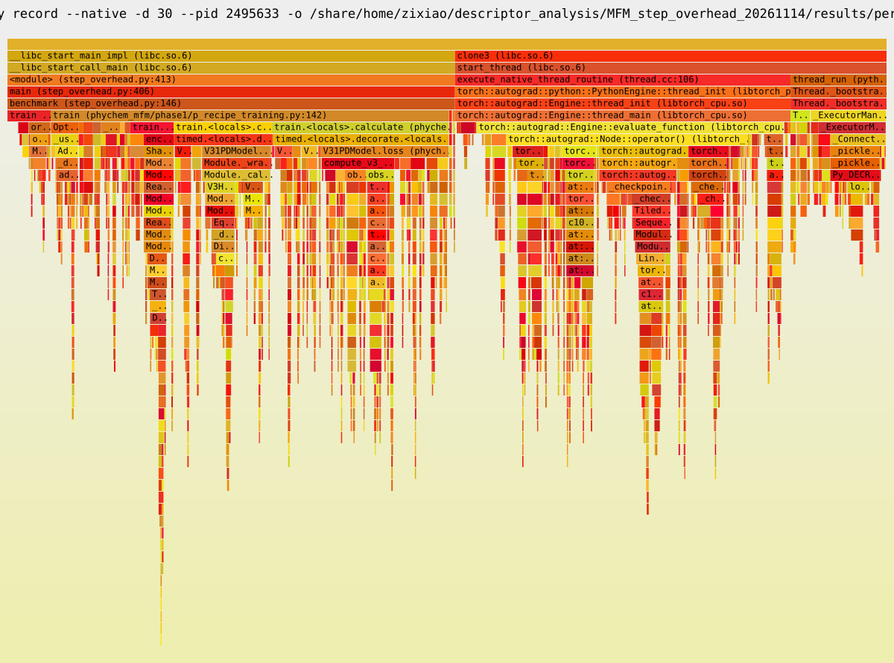
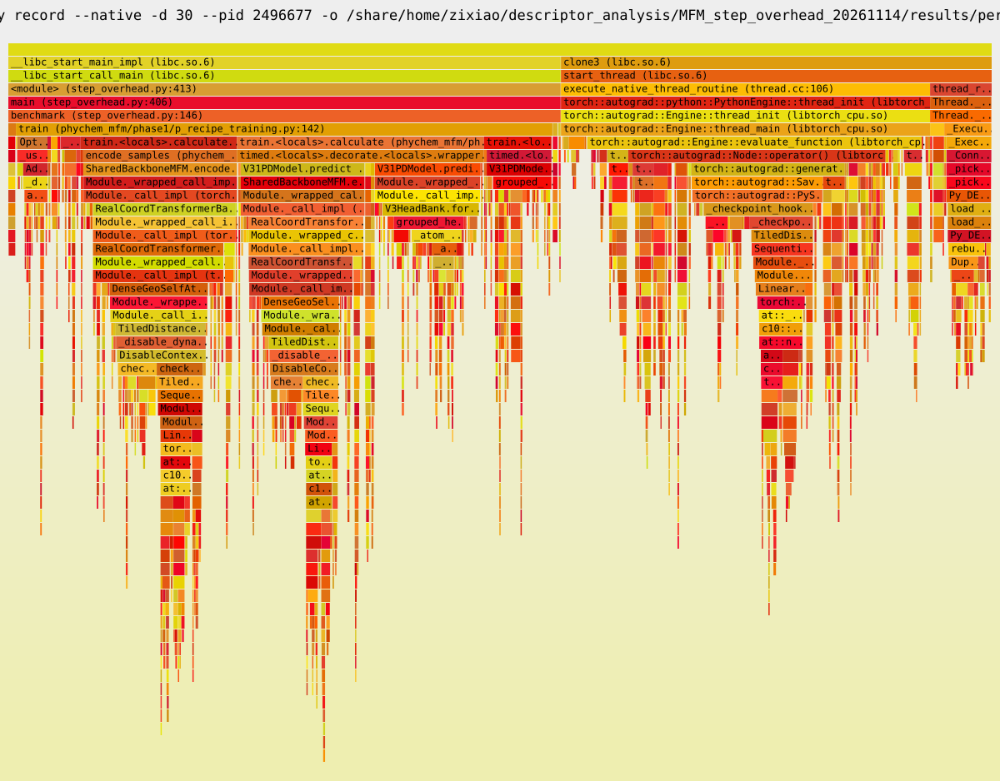

# P/B32 每步 CPU 提速：1.370×
分支 `perf/step-overhead-20261114`，最终代码 [3067619](https://github.com/mint258/MFM/commit/3067619b49e9071ef376461910a8fe4803c1860f)；[PR #8](https://github.com/mint258/MFM/pull/8)。只实施任务书三项，保持参数名、旧检查点、A1–A5/C4及B1–B4原有定义。

同一空闲3090（node7，UUID `GPU-9db54192-dd3f-3177-e56f-dcd161ff932c`），Torch2.7.1+cu118、驱动520.61.05；每版100步预热+1000步计时，C1-0/P、B32、FP32、TF32关、lr3e-4、原3M预算及11-07全TRAIN归一化。5090均被P占用，node20的4090受Slurm COMPLETING阻挡，按用户允许的3090回退执行。

| 累计版本 | 样本/秒 | 相对前版 | 主进程CPU%¹ | 整卡W | 峰值GiB |
|---|---:|---:|---:|---:|---:|
| 原实现 | 52.25 | — | 99.3 | 271.4 | 5.43 |
| +分组预测/掩码/Huber | 59.08 | 1.131× | 100.4 | 289.8 | 5.59 |
| +关闭向量头重算 | 60.39 | 1.022× | 100.2 | 291.2 | 5.84 |
| +读进程准备CPU张量/四批预取 | **71.60** | **1.186×** | 100.8 | 311.9 | 5.84 |

¹单核=100%，包含主进程内所有线程。最终较原实现提升**37.0%**，三项均≥0.98×前版，达到≥1.15×目标。距离分块关闭时首个重批OOM；按规则保留分块，仅关闭向量头重算，8个重批完成，峰值5.72GiB（`capacity_policy.json`）。

| 单步权重（各20批） | ε_loss² | ε_grad² | 最大损失绝对差 | 最大梯度相对L2差 | 判定 |
|---|---:|---:|---:|---:|---|
| 随机种子0 | 2.745e-4 | 8.289e-4 | 9.766e-4 | 2.640e-7 | 通过 |
| G1 3M | 2.745e-4 | 8.289e-4 | 8.024e-6 | 1.576e-3 | 通过 |

²同卡旧实现两遍在全部字段/批次/两组权重上的最大噪声底；逐字段使用任务书绝对/相对混合门，梯度门8.289e-3，所有单步通过。120份原始完整梯度（每份24,755,300分量）及参数布局索引已保存。空字段参数仍为None梯度，G1检查点严格直接加载。最终加载路径1000批分子/构象及提交RNG逐批一致，20批全部入卡前张量、掩码、配对/补齐索引逐元素相等。GPU编码仍由主进程完成，CPU结构编码和每样本处理在读进程。

| [旧实现原生火焰图](../../results/perf_step_overhead_20261114/timing3090_4532627/profile_old/flame.svg) | [最终实现原生火焰图](../../results/perf_step_overhead_20261114/timing3090_4532627/profile_new/flame.svg) |
|---|---|
|  |  |

另行原生采样30秒、100Hz，不纳入测速。损失栈占比19.6%→6.6%，主进程CPU输入3.52%→0.22%，IPC9.11%→4.78%。占比为各自30秒窗口的采样栈覆盖率。

验证：唯一新增合成单测通过；全量回归3592通过、24跳过，1项既有失败为测试引用目标分支已删除的`refit_d4.py`；本次冻结来源问题已修复并通过补测。仓库检查通过。完整数值、计时与图见[证据索引](../../results/perf_step_overhead_20261114/README.md)；原始CSV、完整JUnit XML保留服务器同名results目录。

**待用户决定：** 最终图中反向逐节点执行38.2%、主干编码28.2%、预测头10.5%的后续优化；本线不扩展实施。PR合并由用户在P研究两轮之间决定。
