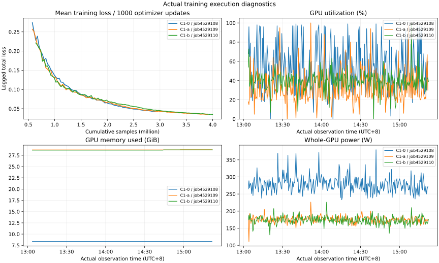

# 模型训练报告

训练进度观测：2026-11-10T16:05:20+08:00（UTC+8）。

当前为训练过程监测。架构与配方评价遵循任务书的完整训练预算。

| 候选 / 实际作业 | 累计样本 | 状态 | 最近1000步总损失均值 | 均值窗口末样本 | 整卡功率 W | 整卡显存 GiB | GPU利用率 % |
|---|---:|---|---:|---:|---:|---:|---:|
| C1-0 / 4529108 | 3,162,912 | RUNNING | 0.039533 | 3,136,000 | 282.67 | 8.36 | 97 |
| C1-a / 4529109 | 4,115,328 | RUNNING | 0.033774 | 4,096,000 | 315.27 | 29.26 | 90 |
| C1-b / 4529110 | 4,182,176 | RUNNING | 0.034555 | 4,160,000 | 430.47 | 29.56 | 97 |

显卡共享情况（与上表系统指标同一次观测）：

| 候选 / 实际作业 | 本训练GPU进程显存 GiB | 其他计算进程数 |
|---|---:|---:|
| C1-0 / 4529108 | 8.34 | 0 |
| C1-a / 4529109 | 28.71 | 1 |
| C1-b / 4529110 | 28.70 | 1 |

最近完整1000更新的分项均值（括号为有效条数）：

| 候选 / 作业 | P |
|---|---:|
| C1-0 / 4529108 | 0.039533 (1000) |
| C1-a / 4529109 | 0.033774 (1000) |
| C1-b / 4529110 | 0.034555 (1000) |

损失为每个实际执行内连续1000优化器更新的算术均值，缺失分项使用各自有效条数；不混合不同续跑的重放记录。原逐步损失继续保存在完整离线SDK中。

功率、整卡显存和利用率属于实际物理卡；本训练GPU进程显存单独列出。其他计算进程数大于0表示观测到同卡共享，整卡高利用率或功率不能归因于本训练；显存占用也不等同于计算占用。系统指标约30秒采样，缺测和超过90秒的间隔断线。图表采用实际观测时间（UTC+8），各组硬件可能不同，不按异构卡或共享卡原始速度选择架构。

系统观测与进度、损失窗口有各自时钟：

- 作业4529108：compute-0-21，`GPU-c35f2434-9137-9723-1af5-dc69b6295243`；系统观测2026-11-10T16:05:44+08:00，对应样本3165152。
- 作业4529109：compute-0-21，`GPU-22e21021-e572-4562-fc51-cd8c83e74141`；系统观测2026-11-10T16:05:44+08:00，对应样本4116736。
- 作业4529110：compute-0-20，`GPU-ec788ed1-7da1-8f93-bb23-b4fdb2018b02`；系统观测2026-11-10T16:05:54+08:00，对应样本4182784。

交付方式：GitHub报告及每10万样本JSON持续更新；W&B保持离线，训练完成后另行提供完整W&B离线运行文件包。
